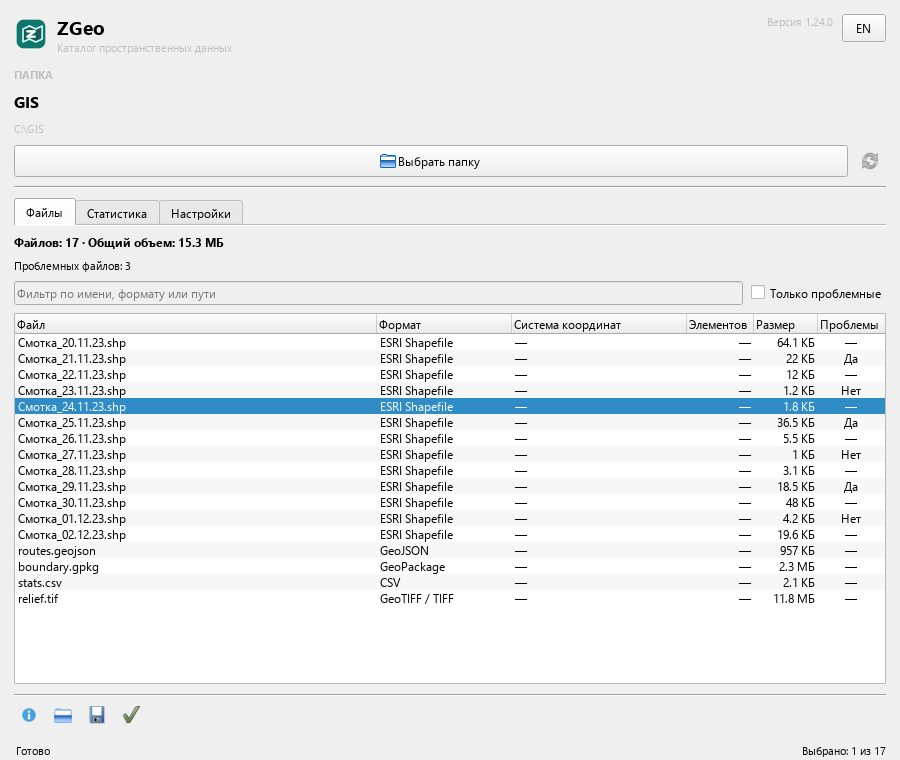
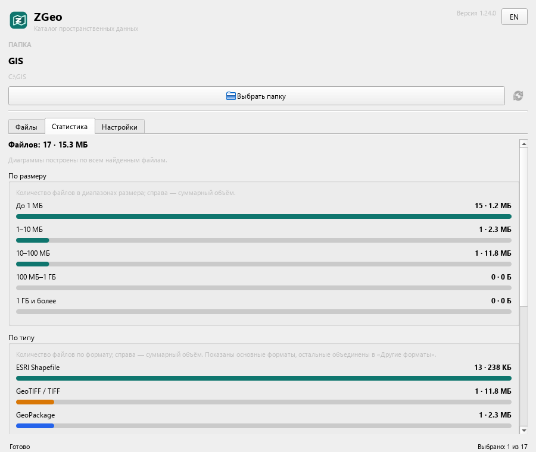
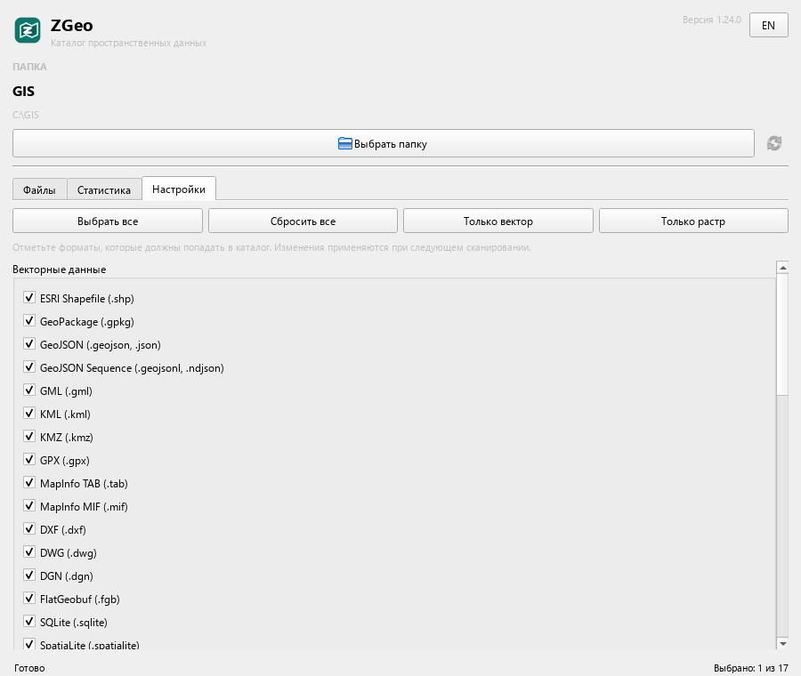

# ZGeo

**Язык:** **Русский** | [English](README_eng.md)

Плагин QGIS для быстрого просмотра содержимого папки с пространственными данными.

Версия плагина: **1.24.0**

Плагин добавляет в QGIS отдельную панель инструментов **«ZGeo»** с кнопкой **«ZGeo-Каталог»**, которая открывает плавающую панель. В панели:

- в верхней части отображается версия плагина;
- в правом верхнем углу панели кнопка **«EN» / «RU»** переключает интерфейс между английским и русским языками без перезапуска QGIS; выбранный язык сохраняется;
- кнопка **«Выбрать папку»** открывает системный диалог выбора каталога;
- имя выбранной папки и полный путь показываются в верхней части панели;
- все поддерживаемые пространственные файлы находятся рекурсивно, включая вложенные папки;
- во время поиска показываются имя текущего найденного файла и число файлов, подходящих под поддерживаемые пространственные форматы, а кнопка **«Прервать»** останавливает сканирование;
- результат выводится списком: относительный путь, формат, система координат, количество элементов и размер файла;
- после сканирования система координат, количество элементов и полный объем наборов данных не читаются автоматически; их можно уточнить в окне **«Проверки»**, ход выполнения отображается в статусной строке и на прогресс-баре;
- над списком показываются количество файлов и их общий объем; при фильтрации объем считается по видимым файлам;
- полный объем учитывает сопутствующие файлы наборов данных (SHP + DBF + SHX + PRJ + CPG и другие, MIF + MID, TAB + DAT/MAP/ID/IND);
- внизу окна расположена статусная строка: слева показывается текущая операция, справа — **«Выбрано: N из M»**; во время сканирования и проверок под статусной строкой отображается прогресс-бар во всю ширину окна с текущим и общим числом файлов;
- список можно фильтровать по имени, формату, пути или наличию проблем;
- на вкладке **«Настройки»** можно отметить форматы, которые нужно искать; вверху доступны кнопки **«Выбрать все»**, **«Сбросить все»**, **«Только вектор»** и **«Только растр»**; формат **Excel** по умолчанию отключён;
- внизу вкладки **«Файлы»** доступны кнопки **«Информация»**, **«Открыть в проводнике»**, **«Экспорт в Excel»** и **«Проверки»**;
- кнопка **«Проверки»** открывает окно **«Проверки»** со списком проверок: **«Уточнить размер»** (первая), **«Уточнить размер SHP»**, **«Уточнить размер MIF/MID»**, **«Уточнить систему координат»**, **«Уточнить количество элементов»**, **«Проверка JSON на формат GEOJSON»**, **«Проверка имён атрибутивных полей»**, **«Проверка имён полей для Shapefile»**, **«Проверка дублей имён после усечения»**, **«Проверка кодировки DBF и .cpg»**, **«Проверка комплектности набора»**, **«Проверка системы координат»**, **«Проверка валидности геометрий»**, **«Проверка координат»** и **«Проверка пустых слоёв»**; проверки включаются флажками, а кнопка **«i»** справа от каждой проверки показывает её описание при наведении; по умолчанию отмечены **«Уточнить размер»**, **«Уточнить систему координат»**, **«Уточнить количество элементов»**, проверка JSON и проверка имён атрибутивных полей;
- проверка JSON появляется, когда в списке есть файлы `.json` или `.geojson`; она проверяет документ по полю `type` и исключает из списка файлы, не являющиеся GeoJSON;
- найденные проблемы показываются в колонке **«Проблемы»** со значениями **«Да»**, **«Нет»** или **«—»**; подробности видны в подсказке к ячейке;
- после проверок показывается строка **«Проблемных файлов: N»** и становится доступен фильтр **«Только проблемные»**;
- уточнение данных, проверку JSON и проверки проблем можно прервать кнопкой отмены;
- для выбранного файла показываются система координат, количество объектов, геометрия, экстент и таблица атрибутивных полей с именами, алиасами, типами, длиной, точностью и комментариями;
- кнопка **«Открыть в проводнике»** открывает проводник Windows с выделенным файлом; для файлов из разных папок открывается отдельное окно на каждую папку;
- на вкладке **«Статистика»** строятся диаграммы по размеру и по типу файлов, а ниже выводится таблица статистики по форматам; после уточнения размера используются полные объемы наборов данных;
- список файлов, таблицу статистики и таблицу атрибутивных полей можно экспортировать в Excel; при экспорте списка статистика по форматам добавляется отдельным листом, для списка и статистики добавляются итоговые цифры, а после сохранения автоматически открывается проводник с выделенным файлом; если колонка **«Проблемы»** была добавлена, она также попадает в экспорт;
- кнопка обновления пересканирует текущую папку.

Поддерживается QGIS 3.16 и новее, включая QGIS 4 / Qt 6.

## Скриншоты

### Вкладка «Файлы»

Результаты проверок, колонка **«Проблемы»**, счётчик проблемных файлов и подсказки с подробностями.



### Вкладка «Статистика»

Диаграммы по размеру и типу файлов, а также таблица статистики по форматам.



### Вкладка «Настройки»

Выбор форматов для сканирования и кнопки быстрого выбора.



## Установка в QGIS

### Из ZIP-архива

Собрать архив:

```powershell
powershell -ExecutionPolicy Bypass -File .\scripts\build_zip.ps1
```

Готовый файл появится в `dist\zgeo-1.18.0.zip`. В QGIS откройте:

**Плагины → Управление и установка плагинов → Установить из ZIP-архива**

и выберите собранный архив.

### Вручную

Скопируйте папку `zgeo` целиком в каталог плагинов QGIS:

- Windows QGIS 4: `%APPDATA%\QGIS\QGIS4\profiles\default\python\plugins\`
- Windows QGIS 3: `%APPDATA%\QGIS\QGIS3\profiles\default\python\plugins\`
- Linux: `~/.local/share/QGIS/QGIS4/profiles/default/python/plugins/`
- macOS: `~/Library/Application Support/QGIS/QGIS4/profiles/default/python/plugins/`

Затем включите **ZGeo** в менеджере плагинов QGIS.

После обновления плагина закройте QGIS полностью и запустите снова. Если панель **«ZGeo»** не появилась, откройте **Плагины → Управление и установка плагинов**, найдите **ZGeo** и убедитесь, что он включён.

## Использование

1. На панели инструментов **«ZGeo»** нажмите кнопку **«ZGeo-Каталог»** (или выберите **Плагины → ZGeo → ZGeo-Каталог**).
2. При необходимости переключите язык кнопкой **«EN» / «RU»** в правом верхнем углу панели.
3. В плавающей панели нажмите **«Выбрать папку»**.
4. Выберите каталог с геоданными.
5. Во время сканирования видны имя текущего найденного файла и число файлов поддерживаемых форматов. Поиск можно остановить кнопкой **«Прервать»**.
6. После завершения имя папки появится вверху, а найденные файлы — в списке. Система координат и количество элементов показываются как **«—»** до выполнения проверок. При необходимости введите часть имени или формата в строку фильтра.
7. Откройте вкладку **«Настройки»**, чтобы выбрать форматы для поиска. Формат **Excel** по умолчанию отключён; после изменения настроек повторите сканирование кнопкой обновления.
8. Нажмите **«Проверки»** и в окне **«Проверки»** отметьте нужные проверки. Доступны уточнение размера, системы координат и количества элементов, проверка JSON, проверка имён атрибутивных полей, а также проверки имён полей для Shapefile, дублей после усечения, кодировки DBF и `.cpg`, комплектности набора, системы координат, валидности геометрий, координат и пустых слоёв. Описание каждой проверки показывается при наведении на кнопку **«i»**. Если в списке есть `.json` или `.geojson`, проверка JSON исключит файлы, которые не являются GeoJSON. После проверок появится строка **«Проблемных файлов: N»**, колонка **«Проблемы»** и станет доступен фильтр **«Только проблемные»**.
9. Выберите файл и нажмите кнопку **«Информация»** внизу списка.
10. Нажмите **«Открыть в проводнике»**, чтобы показать файл в Windows.
11. Нажмите **«Экспорт в Excel»**, чтобы выгрузить список найденных файлов с итоговой строкой и отдельным листом статистики. После сохранения проводник откроется с выделенным `.xlsx`.
12. Откройте вкладку **«Статистика»**, чтобы посмотреть диаграммы.

Последняя выбранная папка запоминается и используется как стартовый каталог в следующий раз.

## Статусная строка

Внизу окна находится статусная строка. Слева отображается состояние текущей операции: сканирование, уточнение размера, системы координат или количества элементов, проверка JSON, проверки проблем с полями и наборами, получение информации, открытие проводника, экспорт в Excel, сообщения об отмене и ошибках. Справа постоянно показывается количество выбранных строк: **«Выбрано: N из M»**. Счетчик обновляется при выборе файлов и при фильтрации списка.

Во время сканирования и длительных проверок под статусной строкой появляется прогресс-бар во всю ширину окна: при сканировании он показывает неопределённый прогресс, при проверках — сколько файлов обработано из общего числа. После завершения операции прогресс-бар скрывается.

## Язык интерфейса

Кнопка **«EN» / «RU»** в правом верхнем углу панели переключает все подписи, подсказки, сообщения статусной строки, заголовки таблиц, диалоги и названия листов Excel. Выбранный язык сохраняется в настройках QGIS и применяется при следующем запуске. Переключение можно выполнять во время сканирования, уточнения данных или проверки атрибутов — текущая операция не прерывается.

## Сканирование

Поиск выполняется в фоновом потоке, поэтому интерфейс QGIS остаётся отзывчивым. Пока идёт сканирование, панель показывает имя текущего найденного файла и число файлов, подходящих под поддерживаемые пространственные форматы. Неподдерживаемые файлы не увеличивают счётчик **«Найдено»**. Кнопка **«Прервать»** останавливает поиск; уже найденные файлы остаются в списке, а статистика строится по частичному результату.

После появления списка колонки **«Система координат»** и **«Элементов»** содержат **«—»**: значения не читаются автоматически. Откройте окно **«Проверки»** и отметьте нужные проверки. Панель обрабатывает файлы по одному через провайдеры QGIS; текущий файл и общий прогресс видны в статусной строке. Рядом с кнопками внизу появляется кнопка отмены, которая прерывает длительную операцию; уже полученные значения сохраняются. Для растровых файлов количество элементов не рассчитывается и показывается **«—»**. Если у набора данных несколько слоёв, количество элементов суммируется, а при разных системах координат в колонке отображается **«Разные»**.

## Настройки форматов

На вкладке **«Настройки»** перечислены все поддерживаемые форматы с чекбоксами, сгруппированные по категориям. Отмеченные форматы участвуют в следующем сканировании. Настройки сохраняются между запусками QGIS.

В верхней части вкладки расположены кнопки быстрого выбора:

- **«Выбрать все»** — отметить все форматы, включая Excel;
- **«Сбросить все»** — снять все отметки;
- **«Только вектор»** — оставить отмеченными только векторные форматы;
- **«Только растр»** — оставить отмеченными только растровые форматы.

После нажатия кнопки настройки сразу сохраняются. Изменения, как и при ручной установке чекбоксов, применяются при следующем сканировании.

Формат **Excel** (`.xls`, `.xlsx`) по умолчанию отключён. Если его включить, таблицы Excel начнут попадать в каталог. После изменения настроек нажмите кнопку обновления в верхней части панели, чтобы пересканировать папку.

## Информация о файле

Кнопка **«Информация»** доступна, когда в списке выбран ровно один файл. Для векторных данных диалог показывает:

- имя файла, формат, размер и полный путь;
- имя слоя и систему координат;
- количество объектов, тип геометрии, экстент и провайдер QGIS;
- таблицу атрибутивных полей: имя, алиас, тип, длину, точность и комментарий.

Для GeoPackage и других контейнеров с несколькими слоями в верхней части диалога появляется выбор слоя. Для растровых файлов показываются система координат, размеры растра, число каналов, размер пикселя и экстент.

Под таблицей атрибутивных полей расположена кнопка **«Экспорт в Excel»**. Она сохраняет поля текущего слоя в файл `.xlsx` и открывает проводник с выделенным файлом.

## Проверки

Кнопка **«Проверки»** внизу вкладки **«Файлы»** открывает окно **«Проверки»**. В нём доступны проверки:

- **«Уточнить размер»** — полный размер каждого набора данных с учётом сопутствующих файлов;
- **«Уточнить размер SHP»** — полный размер только наборов ESRI Shapefile с учётом сопутствующих файлов;
- **«Уточнить размер MIF/MID»** — полный размер только наборов MapInfo MIF/MID с учётом файлов `.mif` и `.mid`;
- **«Уточнить систему координат»** — чтение системы координат слоёв;
- **«Уточнить количество элементов»** — подсчёт объектов в слоях;
- **«Проверка JSON на формат GEOJSON»** — проверка файлов `.json` и `.geojson` по полю `type`; файлы, не являющиеся GeoJSON, исключаются из списка;
- **«Проверка имён атрибутивных полей»** — нелатинские символы в именах полей;
- **«Проверка имён полей для Shapefile»** — длина имени (не более 10 символов DBF), пробелы и недопустимые символы;
- **«Проверка дублей имён после усечения»** — поля, имена которых совпадают после усечения до 10 символов;
- **«Проверка кодировки DBF и .cpg»** — наличие файла `.cpg` и известная кодировка DBF;
- **«Проверка комплектности набора»** — обязательные файлы: `.shp` + `.dbf` + `.shx`, `.mif` + `.mid`, `.tab` + `.dat/.map/.id`;
- **«Проверка системы координат»** — отсутствующая, неизвестная или смешанная система координат;
- **«Проверка валидности геометрий»** — самопересечения, незамкнутые кольца, пустые и null-геометрии;
- **«Проверка координат»** — NaN/Inf, слишком большие координаты, перепутанные широта и долгота, выход за допустимый диапазон CRS;
- **«Проверка пустых слоёв»** — пустые слои и файлы с нулевым количеством объектов.

Проверки включаются флажками. Справа от каждой проверки находится кнопка **«i»**; при наведении на неё показывается описание проверки. По умолчанию отмечены **«Уточнить размер»**, **«Уточнить систему координат»**, **«Уточнить количество элементов»**, **«Проверка JSON на формат GEOJSON»** и **«Проверка имён атрибутивных полей»**; отдельные проверки размера SHP и MIF/MID и восемь проверок проблем включаются по желанию. Проверка **«Уточнить размер»** охватывает все форматы, включая SHP и MIF/MID, и при выборе имеет приоритет над отдельными проверками размера, поэтому они не выполняются повторно.

Проверка JSON появляется в окне, только если среди найденных файлов есть `.json` или `.geojson`. Она читает документ и проверяет поле `type`: допустимы `FeatureCollection`, `Feature`, `GeometryCollection` и геометрические типы (`Point`, `MultiPoint`, `LineString`, `MultiLineString`, `Polygon`, `MultiPolygon`). У коллекций проверяются вложенные объекты `features` и `geometries`. Если документ не является GeoJSON (например, обычный JSON-объект без `type` или с неизвестным `type`), файл исключается из списка, а количество файлов, объём и статистика пересчитываются. Проверка выполняется до уточнения размера, системы координат и количества элементов, поэтому остальные проверки работают уже с отфильтрованным списком.

Проверки проблем проходят по найденным файлам и складывают все замечания в колонку **«Проблемы»**: **«Да»** — найдены проблемы, **«Нет»** — проблем не найдено, **«—»** — проверка к файлу не применима. Подробный список проблем показывается в подсказке к ячейке. Проверка кодировки проверяет наличие `.cpg`, пустой файл и известность указанной кодировки. Проверка комплектности ищет отсутствующие обязательные файлы набора. Проверка системы координат отмечает файлы без СК, с неизвестной СК и файлы, у слоёв которых системы координат различаются. Проверка валидности геометрий ищет самопересечения, незамкнутые кольца, пустые и null-геометрии. Проверка координат ищет NaN/Inf, слишком большие значения, перепутанные широту и долготу и координаты вне допустимого диапазона CRS; для проекционных систем координат точки дополнительно проверяются по области применения CRS. Проверка пустых слоёв отмечает слои без объектов и файлы, в которых объектов нет вообще.

Колонка **«Проблемы»** появляется после первой проверки проблем. Ход проверки отображается в статусной строке и на прогресс-баре. Если колонка уже добавлена, она включается и в экспорт списка файлов.

После завершения проверок над списком показывается строка **«Проблемных файлов: N»**, а под строкой поиска становится доступен флажок **«Только проблемные»**. Он оставляет в таблице только файлы со значением **«Да»** и может сочетаться с текстовым фильтром. Если проверка была прервана, сохраняются уже полученные результаты, а в подсказке к счётчику указывается, сколько файлов успело обработаться.

Проверки можно прервать кнопкой отмены рядом с кнопкой **«Проверки»**. После отмены уже полученные результаты сохраняются, а файлы, уже признанные не-GeoJSON, остаются исключёнными.

## Экспорт списка файлов

Кнопка **«Экспорт в Excel»** внизу вкладки **«Файлы»** сохраняет текущий список в `.xlsx`. В файл попадают колонки **«Файл»**, **«Формат»**, **«Система координат»**, **«Элементов»** и **«Размер»**. Если колонка **«Проблемы»** была добавлена, она также выгружается. Если включён фильтр, на лист **«Файлы»** выгружаются только видимые строки.

В конце таблицы добавляется пустая строка и итог: **«Итого файлов: N»**, суммарное количество элементов и общий размер. Если количество элементов для части файлов ещё не уточнено или не определено, в итоговой ячейке показывается **«—»**.

В той же книге создаётся отдельный лист **«Статистика»** с колонками **«Формат»**, **«Кол-во»** и **«Полный объем»**. Он строится по всем найденным файлам, как и таблица на вкладке **«Статистика»**, и заканчивается строкой **«Итого»** с общим количеством файлов и объемом. После успешного сохранения автоматически открывается проводник Windows с выделенным `.xlsx`.

## Полный объем наборов данных

Полный объем каждого набора данных уточняется проверкой **«Уточнить размер»** для всех форматов сразу, включая SHP и MIF/MID. Если нужно обработать только один формат, используйте отдельные проверки **«Уточнить размер SHP»** или **«Уточнить размер MIF/MID»**. Учитываются сопутствующие файлы:

- Shapefile: `.shp`, `.dbf`, `.shx`, `.prj`, `.cpg`, `.qix`, `.sbn`, `.sbx`, `.fbn`, `.fbx`, `.ain`, `.aih`, `.atx`, `.ixs`, `.mxs`, `.fix`, `.shp.xml`;
- MapInfo MIF: `.mif` + `.mid`;
- MapInfo TAB: `.tab`, `.dat`, `.map`, `.id`, `.ind`;
- CSV: `.csvt`, `.prj`;
- растры: world-файлы `.tfw`/`.wld`, `.prj`, `.aux.xml` и `.ovr` (для поддерживаемых растровых форматов).

Во время обработки в статусной строке показываются число обработанных файлов и имя текущего файла, а прогресс-бар внизу окна показывает ход выполнения. Размер в таблице обновляется по мере чтения. После завершения обновляются общий объем в сводке и вкладка **«Статистика»**. Выделение строк и активный фильтр сохраняются.

## Открытие в проводнике

Кнопка **«Открыть в проводнике»** доступна для одного или нескольких выбранных файлов. В Windows открывается проводник с выделенным файлом. Если выбранные файлы находятся в разных папках, открывается отдельное окно проводника для каждой папки. Если в одной папке выбрано несколько файлов, открывается окно с первым из них.

## Статистика

После каждого сканирования на вкладке **«Статистика»** обновляются две диаграммы и таблица:

- **«По размеру»** — количество файлов в диапазонах: до 1 МБ, 1–10 МБ, 10–100 МБ, 100 МБ–1 ГБ, 1 ГБ и более. Справа показан суммарный объём файлов в диапазоне.
- **«По типу»** — количество файлов по форматам. Справа показан суммарный объём; при большом числе форматов редкие объединяются в «Другие форматы».
- **«Статистика по форматам»** — полная таблица с колонками **«Формат»**, **«Кол-во»** и **«Полный объем»**. В отличие от диаграммы, таблица показывает каждый формат отдельно.

Диаграммы и таблица строятся по всем найденным файлам и не зависят от фильтра списка. После уточнения размера в статистике используются полные объемы наборов данных с учетом сопутствующих файлов.

Под таблицей форматов расположена кнопка **«Экспорт в Excel»**. В файл `.xlsx` выгружаются колонки «Формат», «Кол-во» и «Полный объем», а в конце добавляется строка **«Итого»** с общим количеством файлов и объемом. После сохранения проводник открывается с выделенным файлом.

## Поддерживаемые форматы

| Категория | Расширения |
|-----------|------------|
| Вектор | `.shp`, `.gpkg`, `.geojson`, `.json`, `.geojsonl`, `.ndjson`, `.gml`, `.kml`, `.kmz`, `.gpx`, `.tab`, `.mif`, `.dxf`, `.dwg`, `.dgn`, `.fgb`, `.sqlite`, `.spatialite`, `.osm`, `.pbf`, `.parquet`, `.arrow` |
| Растр | `.tif`, `.tiff`, `.cog`, `.img`, `.asc`, `.dem`, `.hgt`, `.jp2`, `.ecw`, `.sid`, `.bil`, `.bsq`, `.bip`, `.nc`, `.hdf`, `.h5`, `.grib`, `.grb`, `.grib2` |
| Таблицы | `.csv`, `.tsv`, `.xls`, `.xlsx` |
| Прочее | `.vrt`, `.mbtiles`, `.pmtiles` |

Служебные файлы наборов данных (`.dbf`, `.shx`, `.prj`, `.shp.xml` и подобные) не выводятся отдельными строками. Список расширений находится в `scanner.py` и легко расширяется.

## Структура проекта

```text
zgeo/
├── __init__.py          # точка входа classFactory
├── README.md            # документация на русском
├── README_eng.md        # документация на английском
├── metadata.txt         # метаданные плагина QGIS
├── plugin.py            # кнопка на панели инструментов и жизненный цикл панели
├── panel.py             # плавающая панель, список и вкладка статистики
├── i18n.py              # словарь переводов и переключение языка
├── scanner.py           # поиск, форматы и группы форматов
├── scan_task.py         # фоновое сканирование с прогрессом и отменой
├── dataset_size.py      # полный объем наборов данных и сопутствующие файлы
├── stats.py             # агрегация файлов по размеру и формату
├── charts.py            # столбчатые диаграммы без внешних зависимостей
├── attribute_check.py   # проверка имён полей на нелатинские символы
├── file_info.py         # сведения о файлах, системе координат и элементах
├── geojson_check.py     # проверка JSON на соответствие GeoJSON
├── quality_check.py     # проверки качества атрибутов, набора данных и слоёв
├── geometry_check.py    # проверки валидности геометрий и координат
├── info_dialog.py       # диалог «Информация»
├── check_dialog.py      # окно выбора проверок и описания проверок
├── explorer.py          # открытие файлов в проводнике
├── formatting.py        # форматирование размеров
├── excel_export.py      # запись таблиц в .xlsx без внешних зависимостей
├── table_export.py      # диалог сохранения таблиц в Excel
├── icon.svg             # иконка плагина
├── img/
│   ├── screen_1.png     # скриншот вкладки «Файлы»
│   ├── screen_2.png     # скриншот вкладки «Статистика»
│   └── screen_3.png     # скриншот вкладки «Настройки»
├── scripts/
│   └── build_zip.ps1    # сборка ZIP для установки
└── tests/
    ├── test_scanner.py        # тесты сканера
    ├── test_dataset_size.py   # полный объем наборов данных
    ├── test_stats.py          # тесты агрегации статистики
    ├── test_explorer.py       # группировка файлов по папкам
    ├── test_formatting.py     # форматирование размеров
    ├── test_attribute_check.py # проверка имён полей
    ├── test_excel_export.py   # формирование XLSX
    ├── test_geojson_check.py  # проверка JSON на GeoJSON
    ├── test_quality_check.py  # проверки качества атрибутов и набора
    ├── test_metadata.py       # метаданные плагина
    ├── test_version.py        # версия плагина
    └── test_i18n.py           # переводы и переключение языка
```

## Разработка

Базовые тесты не требуют QGIS и PyQt:

```powershell
cd zgeo
python -m unittest discover -s tests -t .. -v
```

Проверка синтаксиса:

```powershell
python -m py_compile __init__.py plugin.py panel.py i18n.py scanner.py scan_task.py dataset_size.py stats.py charts.py attribute_check.py file_info.py quality_check.py geometry_check.py geojson_check.py info_dialog.py check_dialog.py explorer.py formatting.py excel_export.py table_export.py version.py
```

Сканирование выполняется в фоновом потоке. Для очень больших каталогов на сетевых дисках список может заполняться постепенно, но интерфейс остаётся отзывчивым, а поиск можно прервать.

---

**Язык:** **Русский** | [English](README_eng.md)
