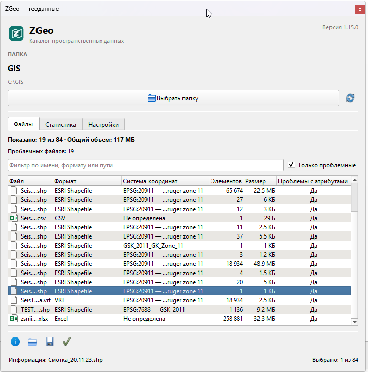
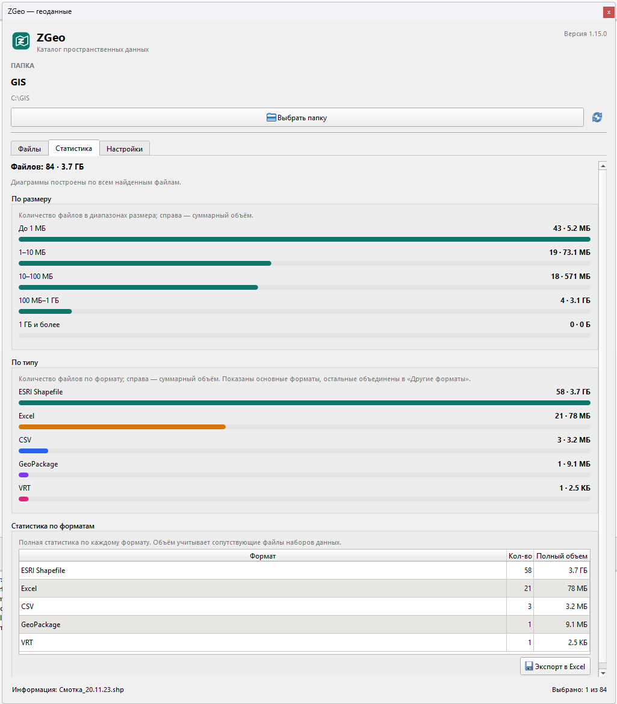
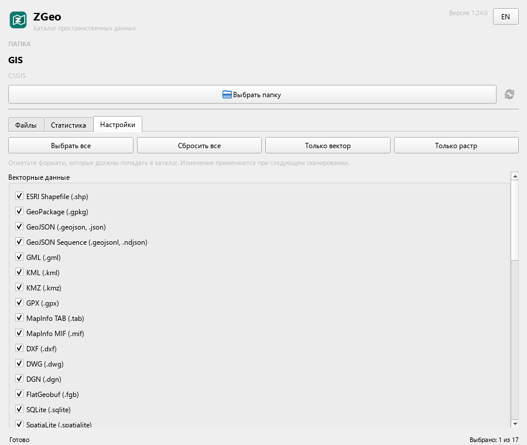

# ZGeo

**Язык:** **Русский** | [English](README_eng.md)

Плагин QGIS для быстрого просмотра содержимого папки с пространственными данными.

> **Проверено:** плагин проверен в QGIS под Windows. Под другими операционными системами (macOS, Linux) работа не проверялась.

Плагин добавляет в QGIS отдельную панель инструментов **«ZGeo»** с кнопкой **«ZGeo-Каталог»**, которая открывает плавающую панель. В панели:

- в верхней части отображается версия плагина;
- в правом верхнем углу панели кнопка **«EN» / «RU»** переключает интерфейс между английским и русским языками без перезапуска QGIS; выбранный язык сохраняется;
- кнопка **«Выбрать папку»** открывает системный диалог выбора каталога;
- имя выбранной папки и полный путь показываются в верхней части панели;
- все поддерживаемые пространственные файлы находятся рекурсивно, включая вложенные папки;
- во время поиска показываются имя текущего найденного файла и число файлов, подходящих под поддерживаемые пространственные форматы, а кнопка **«Прервать»** останавливает сканирование;
- результат выводится списком: относительный путь, формат, система координат, количество элементов и размер файла;
- после сканирования система координат, количество элементов и полный объем наборов данных не читаются автоматически; их можно уточнить на закладках **«Качество пространственных данных»** и **«Качество атрибутивных данных»**, ход выполнения отображается в статусной строке и на прогресс-баре;
- над списком показываются количество файлов и их общий объем; при фильтрации объем считается по видимым файлам;
- полный объем учитывает сопутствующие файлы наборов данных (SHP + DBF + SHX + PRJ + CPG и другие, MIF + MID, TAB + DAT/MAP/ID/IND);
- внизу окна расположена статусная строка: слева показывается текущая операция, справа — **«Выбрано: N из M»**; во время сканирования и проверок под статусной строкой отображается прогресс-бар во всю ширину окна с текущим и общим числом файлов, а над ним — название только текущей проверки;
- список можно фильтровать по имени, формату, пути или наличию проблем;
- на вкладке **«Настройки»** можно отметить форматы, которые нужно искать; вверху доступны кнопки **«Выбрать все»**, **«Сбросить все»**, **«Только вектор»** и **«Только растр»**; формат **Excel** по умолчанию отключён;
- внизу вкладки **«Файлы»** доступны кнопки **«Информация»**, **«Открыть в проводнике»**, **«Скопировать в …»**, маленькая кнопка **«Добавить в текущий проект»**, **«Проверки»** и **«Экспорт»**; кнопка **«Экспорт»** открывает выбор формата — Excel или HTML; кнопка **«Добавить в текущий проект»** загружает выделенные файлы слоями в текущий проект QGIS;
- после первого сканирования становятся доступны закладки **«Качество пространственных данных»** и **«Качество атрибутивных данных»**; до первого сканирования они отключены; кнопка **«Проверки»** открывает закладку **«Качество пространственных данных»**; проверки разделены между закладками по смыслу, включаются флажками, а кнопка **«i»** справа от каждой проверки открывает панель с подробным описанием, списком действий и примерами; по умолчанию отмечены **«Уточнить размер»**, **«Уточнить систему координат и проверить СК»**, **«Уточнить количество элементов»**, проверка JSON и проверка имён полей; проверки читаемости файлов, дублей имён полей, заполненности атрибутов, полей-пустышек, управляющих и невидимых символов, дублей по атрибутам, пустых строк, пробелов по краям значений, двойных пробелов внутри значений, чисел, записанных как текст, смешанных типов в поле, аномальной длины текста, дат вне разумного диапазона, подозрительных имён полей, кодировки текста, несоответствия расширения и содержимого, дублей по атрибутам и геометрии, целостности GeoPackage/SQLite и топологии включаются по желанию;
- проверка JSON появляется, когда в списке есть файлы `.json` или `.geojson`; она проверяет документ по полю `type` и исключает из списка файлы, не являющиеся GeoJSON; дополнительная проверка **«Проверка GeoJSON»** анализирует координаты, замкнутость колец, `bbox` и структуру `Feature`/`GeometryCollection`;
- проверка **«Проверка заполненности атрибутов»** ищет NULL, пустые строки и строки из пробелов, считает долю заполнения по полям, обязательные поля и почти пустые слои; проверка **«Поля-пустышки (100% NULL)»** ищет столбцы, у которых все значения NULL или пустые строки и которые нечего экспортировать; проверка **«Смешанные типы в поле»** ищет текстовые столбцы, где вместе встречаются числа и текст; проверка **«Проверка топологии»** ищет наложения и разрывы полигонов, висячие линии и пересечения линий;
- найденные проблемы показываются в колонке **«Проблемы»** со значениями **«Да»**, **«Нет»** или **«—»**; подробности видны в подсказке к ячейке;
- после проверок показывается строка **«Проблемных файлов: N»** и становится доступен фильтр **«Только проблемные»**;
- уточнение данных, проверку JSON и проверки проблем можно прервать кнопкой отмены;
- для выбранного файла показываются система координат, количество объектов, геометрия, экстент и таблица атрибутивных полей с именами, алиасами, типами, длиной, точностью и комментариями;
- кнопка **«Открыть в проводнике»** открывает проводник Windows с выделенным файлом; для файлов из разных папок открывается отдельное окно на каждую папку;
- кнопка **«Скопировать в …»** копирует выбранные наборы данных вместе с сопутствующими файлами в выбранную папку, показывает прогресс и позволяет отменить операцию; если в папке уже есть файлы с такими именами, программа попросит подтвердить замену, а после успешного копирования откроет проводник в папке назначения;
- на вкладке **«Статистика»** строятся диаграммы по размеру и по типу файлов, а ниже выводится таблица статистики по форматам; после уточнения размера используются полные объемы наборов данных;
- список файлов, таблицу статистики и таблицу атрибутивных полей можно экспортировать в Excel, а полный отчёт по списку — ещё и в автономный HTML; формат выбирается в меню кнопки **«Экспорт»**; при экспорте списка статистика по форматам добавляется отдельным листом, для списка и статистики добавляются итоговые цифры, а после сохранения автоматически открывается проводник с выделенным файлом; если колонка **«Проблемы»** была добавлена, она также попадает в экспорт; для выполненных проверок в отчёт добавляется время операций и скорость обработки в файлах в секунду и в минуту;
- кнопка обновления пересканирует текущую папку.

Поддерживается QGIS 3.16 и новее, включая QGIS 4 / Qt 6.

## Скриншоты

### Вкладка «Файлы»

Результаты проверок, колонка **«Проблемы»**, счётчик проблемных файлов и подсказки с подробностями.



### Вкладка «Статистика»

Диаграммы по размеру и типу файлов, а также таблица статистики по форматам.



### Вкладка «Настройки»

Выбор форматов для сканирования и кнопки быстрого выбора.



### HTML-отчёт

Автономный HTML-отчёт с вкладками проверок, статистикой по форматам и временем проверки.


## Установка в QGIS

### Из ZIP-архива

Собрать архив:

```powershell
powershell -ExecutionPolicy Bypass -File .\scripts\build_zip.ps1
```

Готовый файл появится в `dist\zgeo-1.18.0.zip`. В QGIS откройте:

**Плагины → Управление и установка плагинов → Установить из ZIP-архива**

и выберите собранный архив.

### Вручную

Скопируйте папку `zgeo` целиком в каталог плагинов QGIS:

- Windows QGIS 4: `%APPDATA%\QGIS\QGIS4\profiles\default\python\plugins\`
- Windows QGIS 3: `%APPDATA%\QGIS\QGIS3\profiles\default\python\plugins\`
- Linux: `~/.local/share/QGIS/QGIS4/profiles/default/python/plugins/`
- macOS: `~/Library/Application Support/QGIS/QGIS4/profiles/default/python/plugins/`

Затем включите **ZGeo** в менеджере плагинов QGIS.

После обновления плагина закройте QGIS полностью и запустите снова. Если панель **«ZGeo»** не появилась, откройте **Плагины → Управление и установка плагинов**, найдите **ZGeo** и убедитесь, что он включён.

## Использование

1. На панели инструментов **«ZGeo»** нажмите кнопку **«ZGeo-Каталог»** (или выберите **Плагины → ZGeo → ZGeo-Каталог**).
2. При необходимости переключите язык кнопкой **«EN» / «RU»** в правом верхнем углу панели.
3. В плавающей панели нажмите **«Выбрать папку»**.
4. Выберите каталог с геоданными.
5. Во время сканирования видны имя текущего найденного файла и число файлов поддерживаемых форматов. Поиск можно остановить кнопкой **«Прервать»**.
6. После завершения имя папки появится вверху, а найденные файлы — в списке. Система координат и количество элементов показываются как **«—»** до выполнения проверок. При необходимости введите часть имени или формата в строку фильтра.
7. Откройте вкладку **«Настройки»**, чтобы выбрать форматы для поиска. Формат **Excel** по умолчанию отключён; после изменения настроек повторите сканирование кнопкой обновления.
8. После первого сканирования откройте закладку **«Качество пространственных данных»** или **«Качество атрибутивных данных»** (кнопка **«Проверки»** открывает пространственную закладку) и отметьте нужные проверки. На пространственной закладке доступны уточнение размера, проверка читаемости файлов, уточнение и проверка системы координат, уточнение количества элементов, проверка JSON и GeoJSON, имён и путей файлов, набора данных, целостности GeoPackage/SQLite, метаданных и CRS, `.prj`, геометрий, топологии, дублей объектов и координат. На закладке атрибутивных данных доступны проверки имён полей, дублей имён полей, заполненности атрибутов, полей-пустышек, управляющих и невидимых символов, дублей по атрибутам, пустых строк, пробелов по краям значений, двойных пробелов внутри значений, чисел, записанных как текст, смешанных типов в поле, аномальной длины текста, дат вне разумного диапазона, подозрительных имён полей, кодировки текста, несоответствия расширения и содержимого и дублей по атрибутам и геометрии. Кнопка **«i»** открывает справа панель с подробным описанием проверки, что будет сделано и примерами. Кнопки **«Выбрать все»**, **«Сбросить все»** и **«По умолчанию»** меняют отметки сразу для всей закладки. Нажмите **«Выполнить выбранные проверки»**. Если в списке есть `.json` или `.geojson`, проверка JSON исключит файлы, которые не являются GeoJSON. После проверок появится строка **«Проблемных файлов: N»**, колонка **«Проблемы»** и станет доступен фильтр **«Только проблемные»**.
9. Выберите файл и нажмите кнопку **«Информация»** внизу списка.
10. Нажмите **«Открыть в проводнике»**, чтобы показать файл в Windows.
11. При необходимости выберите один или несколько файлов и нажмите **«Скопировать в …»**, чтобы скопировать наборы данных вместе с сопутствующими файлами в другую папку. Чтобы открыть выделенные файлы слоями в текущем проекте, нажмите маленькую кнопку **«Добавить в текущий проект»**.
12. Нажмите **«Экспорт»** и выберите **Excel** или **HTML**, чтобы выгрузить список найденных файлов с итоговой строкой и статистикой. После сохранения проводник откроется с выделенным `.xlsx` или `.html`.
13. Откройте вкладку **«Статистика»**, чтобы посмотреть диаграммы.

Последняя выбранная папка запоминается и используется как стартовый каталог в следующий раз.

## Статусная строка

Внизу окна находится статусная строка. Слева отображается состояние текущей операции: сканирование, уточнение размера, системы координат или количества элементов, проверка JSON, проверки проблем с полями и наборами, получение информации, открытие проводника, копирование файлов, экспорт в Excel или HTML, сообщения об отмене и ошибках. Справа постоянно показывается количество выбранных строк: **«Выбрано: N из M»**. Счетчик обновляется при выборе файлов и при фильтрации списка.

Во время сканирования и длительных проверок под статусной строкой появляется прогресс-бар во всю ширину окна: при сканировании он показывает неопределённый прогресс, при проверках — сколько файлов обработано из общего числа. Над прогресс-баром выводится название только текущей проверки или операции. После завершения операции прогресс-бар и название скрываются.

## Язык интерфейса

Кнопка **«EN» / «RU»** в правом верхнем углу панели переключает все подписи, подсказки, сообщения статусной строки, заголовки таблиц, диалоги, названия листов Excel и разделов HTML. Выбранный язык сохраняется в настройках QGIS и применяется при следующем запуске. Переключение можно выполнять во время сканирования, уточнения данных или проверки атрибутов — текущая операция не прерывается.

## Сканирование

Поиск выполняется в фоновом потоке, поэтому интерфейс QGIS остаётся отзывчивым. Пока идёт сканирование, панель показывает имя текущего найденного файла и число файлов, подходящих под поддерживаемые пространственные форматы. Неподдерживаемые файлы не увеличивают счётчик **«Найдено»**. Кнопка **«Прервать»** останавливает поиск; уже найденные файлы остаются в списке, а статистика строится по частичному результату.

После появления списка колонки **«Система координат»** и **«Элементов»** содержат **«—»**: значения не читаются автоматически. Откройте закладку **«Качество пространственных данных»** (кнопка **«Проверки»**) или **«Качество атрибутивных данных»** и отметьте нужные проверки. Панель обрабатывает файлы по одному через провайдеры QGIS; текущий файл и общий прогресс видны в статусной строке. Рядом с кнопками внизу появляется кнопка отмены, которая прерывает длительную операцию; уже полученные значения сохраняются. Для растровых файлов количество элементов не рассчитывается и показывается **«—»**. Если у набора данных несколько слоёв, количество элементов суммируется, а при разных системах координат в колонке отображается **«Разные»**.

## Настройки форматов

На вкладке **«Настройки»** перечислены все поддерживаемые форматы с чекбоксами, сгруппированные по категориям. Отмеченные форматы участвуют в следующем сканировании. Настройки сохраняются между запусками QGIS.

В верхней части вкладки расположены кнопки быстрого выбора:

- **«Выбрать все»** — отметить все форматы, включая Excel;
- **«Сбросить все»** — снять все отметки;
- **«Только вектор»** — оставить отмеченными только векторные форматы;
- **«Только растр»** — оставить отмеченными только растровые форматы.

После нажатия кнопки настройки сразу сохраняются. Изменения, как и при ручной установке чекбоксов, применяются при следующем сканировании.

Формат **Excel** (`.xls`, `.xlsx`) по умолчанию отключён. Если его включить, таблицы Excel начнут попадать в каталог. После изменения настроек нажмите кнопку обновления в верхней части панели, чтобы пересканировать папку.

## Информация о файле

Кнопка **«Информация»** доступна, когда в списке выбран ровно один файл. Для векторных данных диалог показывает:

- имя файла, формат, размер и полный путь;
- имя слоя и систему координат;
- количество объектов, тип геометрии, экстент и провайдер QGIS;
- таблицу атрибутивных полей: имя, алиас, тип, длину, точность и комментарий.

Для GeoPackage и других контейнеров с несколькими слоями в верхней части диалога появляется выбор слоя. Для растровых файлов показываются система координат, размеры растра, число каналов, размер пикселя и экстент.

Под таблицей атрибутивных полей расположена кнопка **«Экспорт в Excel»**. Она сохраняет поля текущего слоя в файл `.xlsx` и открывает проводник с выделенным файлом.

## Проверки

После первого сканирования в главном окне становятся доступны две закладки. До первого сканирования они отключены. Проверки разделены между закладками по смыслу.

**«Качество пространственных данных»** — кнопка **«Проверки»** внизу вкладки **«Файлы»** открывает эту закладку. На ней доступны:

- **«Уточнить размер»** — полный размер каждого набора данных с учётом сопутствующих файлов, включая SHP и MIF/MID;
- **«Проверка читаемости файлов»** — открытие каждого файла через провайдеры QGIS, проверка доступных слоёв и чтение одного объекта векторного слоя или небольшой выборки пикселей растра; отмечаются отсутствующие и пустые файлы, ошибки открытия и чтения;
- **«Уточнить систему координат и проверить СК»** — чтение СК, заполнение колонки «Система координат» и отметка отсутствующей, неизвестной или смешанной СК;
- **«Уточнить количество элементов»** — подсчёт объектов и заполнение колонки «Элементов» для всех слоёв файла; проверка только уточняет данные и не отмечает файлы как проблемные;
- **«Проверка JSON на формат GEOJSON»** — проверка файлов `.json` и `.geojson` по полю `type`; файлы, не являющиеся GeoJSON, исключаются из списка;
- **«Проверка GeoJSON»** — координаты (NaN/Inf, диапазон долготы и широты, перепутанные оси), замкнутость колец и минимальное число точек, `bbox` и структура `Feature`, `FeatureCollection` и `GeometryCollection`;
- **«Несоответствие расширения и содержимого»** — файл, который не является тем форматом, что указан в расширении: «шейпфайл» с ZIP-архивом внутри, `.gpkg` без заголовка SQLite, `.tif` с текстом. Проверка читает сигнатуры SQLite, Shapefile, ZIP, TIFF, JPEG 2000, NetCDF, HDF, Parquet, Arrow, FlatGeobuf, PMTiles, OLE2, JSON и XML.
- **«Проверка имён и путей файлов»** — длина полного пути больше 260 символов, недопустимые и зарезервированные имена, имена, различающиеся только регистром, осиротевшие сопутствующие файлы;
- **«Проверка набора данных»** — обязательные файлы: `.shp` + `.dbf` + `.shx`, `.mif` + `.mid`, `.tab` + `.dat/.map/.id`, а также наличие `.cpg` и корректность кодировки DBF;
- **«Проверка целостности GeoPackage/SQLite»** — `PRAGMA quick_check` и при ошибке `PRAGMA integrity_check`, `PRAGMA foreign_key_check`, обязательные таблицы GeoPackage, наличие таблиц и геометрических колонок, ссылки на SRS и согласованность `srs_id`;
- **«Проверка метаданных и CRS»** — отсутствие `.prj` и `.cpg` у SHP, `.aux.xml` и `.ovr` у растров, файла привязки `.tfw/.tifw/.wld` при отсутствии CRS, устаревшие CRS, CRS без кода EPSG/авторитета, не метрические единицы и нестандартный порядок осей;
- **«Проверка .prj-файла»** — наличие файла `.prj` (или `.qpj`), его читаемость, пустой файл, корректность WKT и согласованность типа CRS и кода EPSG с системой координат слоя;
- **«Проверка валидности геометрий»** — самопересечения, незамкнутые кольца, пустые и null-геометрии;
- **«Проверка топологии»** — наложения полигонов по площади, замкнутые разрывы между полигонами, висячие концы линий, внутренние пересечения и наложения линий;
- **«Дубли по атрибутам и геометрии»** — объекты, у которых совпадают и значения всех атрибутов, и геометрия. Отдельные проверки ищут дубли только по геометрии и только по атрибутам; здесь отмечаются полные копии одной записи, которые задваивают суммы и площади и дают двойные подписи на карте.
- **«Проверка дублей объектов»** — объекты с полностью совпадающей геометрией (побайтовое сравнение WKB: тип, число вершин и все координаты, включая Z);
- **«Проверка координат»** — NaN/Inf, слишком большие значения, перепутанные широта и долгота, координаты вне допустимого диапазона CRS.

**«Качество атрибутивных данных»** — на этой закладке доступны:

- **«Проверка имён полей»** — нелатинские символы, длина имени (не более 10 символов DBF), пробелы, недопустимые символы и дубли после усечения;
- **«Проверка дублей имён полей»** — имена атрибутивных полей, совпадающие без учёта регистра в одном слое;
- **«Проверка заполненности атрибутов»** — NULL, пустые строки и строки из пробелов, доля заполнения по каждому полю, обязательные поля с пустыми значениями, поля с заполненностью ниже 50% и почти пустые слои;
- **«Поля-пустышки (100% NULL)»** — столбцы, у которых все значения NULL или пустые строки. Такие поля нечего экспортировать, они занимают место в схеме и могут ломать обмен данными;
- **«Управляющие и невидимые символы»** — табуляция, перевод строки, возврат каретки, вертикальная табуляция, перевод формата, NUL и ESC, а также неразрывные и нулевой ширины пробелы, мягкий перенос, разделители строк и абзацев, метка порядка байтов и другие форматирующие символы Unicode в текстовых значениях. Обычный пробел проблемой не считается; в отчёте показываются названия символов, число объектов и пример значения с заменами \t, \n и \uXXXX;
- **«Дубли по атрибутам (очень долго!)»** — полные дубли строк (совпадают все атрибутивные столбцы), дубли составного ключа (совпадают все текстовые столбцы), совпадения без учёта регистра и лишних пробелов («Москва» и «москва ») и частичные вхождения, когда значение целиком входит в другое значение того же поля, с процентом вхождения. Двойной щелчок по ячейке таблицы результатов открывает подробный список с процентами. Проверка читает все объекты и сравнивает значения попарно, поэтому на больших наборах данных работает очень долго.
- **«Пустые строки»** — текстовые поля, где значение пустое или состоит только из пробелов. Для пользователя такие значения не отличаются от NULL, но ведут себя иначе в запросах: `IS NULL` их не находит, а сортировка и группировка дают отдельную группу; в отчёте показывается число и доля пустых строк по каждому полю.
- **«Пробелы по краям значений»** — значения с ведущими или замыкающими пробелами, табуляцией и переводами строк. Такие значения не совпадают при сравнении и соединении («Москва» и «Москва » считаются разными), из-за чего ломаются справочники, фильтры и связи между слоями; в отчёте показывается, сколько значений с пробелами в начале и сколько в конце, и пример с видимыми символами («·Москва·», «\tТверь»).
- **«Двойные пробелы внутри значений»** — значения, внутри которых стоят два и более пробела подряд. Обычно это следствие ручного ввода или склейки полей: такие записи не находятся поиском по точному значению и выглядят неряшливо в отчётах; в отчёте показывается число объектов, доля и пример с видимыми пробелами («Москва··Сити»).
- **«Числа, записанные как текст»** — текстовые столбцы, где значения являются числами (идентификаторы, площади, коды). Из-за текстового типа сравнение идёт по алфавиту («10» меньше «9») и невозможны арифметические операции; в отчёте показывается число объектов, доля, сколько значений целых и сколько дробных, и пример.
- **«Смешанные типы в поле»** — текстовые столбцы, где одновременно встречаются числа и текст, например «10», «20» и «N/A». Excel и SQL могут определить тип такого столбца по-разному: часть значений станет числом, часть останется текстом, из-за чего ломаются сортировка, суммы, фильтры, импорт в Excel и запросы SQL; в отчёте показываются число числовых и текстовых значений, доли и примеры обоих видов.
- **«Кодировка текста (кракозябры)»** — значения, которые выглядят как текст, прочитанный не в той кодировке: `МоÑква` вместо `Москва`. Такие значения появляются, когда файл сохранён не в той кодировке или UTF-8 прочитали как однобайтовую кодировку; их невозможно найти поиском, они ломают сортировку и сравнение с эталонными значениями. В отчёте показываются число объектов, доля, пример и исправленный текст, если его удалось восстановить.
- **«Аномальная длина текста»** — для каждого текстового столбца считаются средняя длина значения и стандартное отклонение, затем отмечаются значения длиннее среднего более чем на три отклонения. Так находятся обрезанные поля справочника и, наоборот, значения со склеенным или лишним текстом; в отчёте показываются среднее, отклонение, самая длинная длина, объекты и пример.
- **«Даты вне разумного диапазона»** — даты и отметки времени раньше 1900 года и позже текущего года. Так выглядят даты, записанные в неверном формате, и результат подстановки нулевой даты: такие значения ломают временные фильтры и хронологию в отчётах. В отчёте показываются число объектов, доля, минимальный и максимальный найденный год и сами значения.
- **«Подозрительные имена полей»** — технические имена после импорта (`Field1`, `field_2`, `Column3`, `Unnamed: 0`), имена, обозначающие отсутствующее значение (`NULL`, `None`, `NaN`), имена из одних цифр и пустое имя. Их нет в справочнике, поэтому слой нельзя сопоставить с эталонной схемой, а отчёты и подписи получают бессмысленные заголовки.

Над списком проверок на каждой закладке расположены кнопки **«Выбрать все»** — отметить все проверки закладки, **«Сбросить все»** — снять все отметки и **«По умолчанию»** — вернуть отметки, заданные по умолчанию. Сам список проверок прокручивается, поэтому закладку можно уменьшить по высоте, не теряя доступ к кнопкам. Кнопка **«Выполнить выбранные проверки»** находится справа над таблицей результатов, на месте, где раньше были кнопки экспорта.

Ниже списка заполняется таблица результатов: в строках — найденные файлы (относительный путь), в колонках — статистика по каждой выбранной проверке. Для проверок проблем в ячейке показывается число найденных замечаний (ноль — проблем нет, тире — проверка к файлу не применима), для **«Уточнить размер»** — полный размер набора, для **«Уточнить систему координат и проверить СК»** — определённая система координат, для **«Уточнить количество элементов»** — количество элементов. Границу между списком и таблицей можно перетаскивать.

Под таблицей результатов находится кнопка **«Экспорт»** с выпадающим списком **«Экспорт в Excel»** и **«Экспорт в HTML»**. В файл попадают только те проверки, которые показаны в колонках текущей закладки. Справа от каждой проверки находится кнопка **«i»**; нажатие открывает справа панель с подробным описанием проверки, что будет сделано и примерами. Панель можно закрыть кнопкой **«×»**, а нажатие на другую кнопку **«i»** переключает её содержимое. По умолчанию отмечены **«Уточнить размер»**, **«Уточнить систему координат и проверить СК»**, **«Уточнить количество элементов»**, **«Проверка JSON на формат GEOJSON»** и **«Проверка имён полей»**; проверка читаемости файлов, проверка GeoJSON, проверка дублей имён полей, проверка заполненности атрибутов, проверка полей-пустышек, проверка управляющих и невидимых символов, проверка дублей по атрибутам, проверка пустых строк, проверка пробелов по краям, проверка двойных пробелов внутри значений, проверка чисел, записанных как текст, проверка аномальной длины текста, проверка дат вне разумного диапазона, проверка подозрительных имён полей, проверка кодировки текста, проверка несоответствия расширения и содержимого, проверка дублей по атрибутам и геометрии, проверка набора данных, проверка целостности GeoPackage/SQLite, проверка метаданных и CRS, проверка .prj-файла, проверка валидности геометрий, проверка топологии, проверка дублей объектов и проверка координат включаются по желанию. Проверка **«Уточнить размер»** охватывает все форматы, включая SHP и MIF/MID.

Проверка JSON появляется на закладке **«Качество пространственных данных»**, только если среди найденных файлов есть `.json` или `.geojson`. Она читает документ и проверяет поле `type`: допустимы `FeatureCollection`, `Feature`, `GeometryCollection` и геометрические типы (`Point`, `MultiPoint`, `LineString`, `MultiLineString`, `Polygon`, `MultiPolygon`). У коллекций проверяются вложенные объекты `features` и `geometries`. Если документ не является GeoJSON (например, обычный JSON-объект без `type` или с неизвестным `type`), файл исключается из списка, а количество файлов, объём и статистика пересчитываются. Проверка выполняется до уточнения размера, системы координат и количества элементов, поэтому остальные проверки работают уже с отфильтрованным списком.

Проверка **«Проверка GeoJSON»** дополняет проверку формата и анализирует содержимое документов `.json` и `.geojson`. Для координат проверяются числовой тип, отсутствие `NaN`/`Inf`, диапазон долготы `[-180, 180]` и широты `[-90, 90]`, а также признаки перепутанных осей. Для линий и полигонов проверяются минимальное число точек и замкнутость колец. Необязательный `bbox` проверяется на уровне документа, объекта, геометрии и коллекции: длина 4 или 6 чисел, конечные значения и порядок минимума и максимума. Дополнительно проверяются обязательные поля и структура `Feature`, `FeatureCollection` и `GeometryCollection`. Проверка отключена по умолчанию и появляется на закладке **«Качество пространственных данных»** вместе с проверкой JSON, когда среди файлов есть `.json` или `.geojson`.

Проверка **«Проверка заполненности атрибутов»** работает с векторными слоями и таблицами и считает пустыми значения `NULL`, пустые строки и строки только из пробелов. Для каждого слоя вычисляется доля заполнения ячеек и доля полностью пустых объектов. Обязательными считаются поля с ограничением `NOT NULL` и поля первичного ключа. Проверка отмечает обязательные поля с пустыми значениями, необязательные поля с заполненностью ниже 50% и почти пустые слои: меньше 5% заполненных ячеек или не менее 95% полностью пустых объектов. В подсказке показывается сводка по слою, а в отчёте — заполненность каждого поля проблемного слоя. Проверка отключена по умолчанию.

Проверка **«Поля-пустышки (100% NULL)»** читает все объекты каждого векторного слоя и таблицы и отмечает поля, у которых не осталось ни одного заполненного значения: все значения `NULL`, пустые строки или строки только из пробелов. Такие столбцы нечего экспортировать: они занимают место в схеме, создают пустые атрибуты, мешают обязательным ограничениям и могут ломать схему и обмен данными. Проверка только сообщает о проблемах и не удаляет поля. В отчёте по каждому такому полю показываются слой, имя поля и число пустых значений. Проверка отключена по умолчанию.

Проверка **«Управляющие и невидимые символы»** читает текстовые поля векторных слоёв и таблиц и ищет в значениях управляющие и невидимые символы. К управляющим относятся табуляция (TAB), перевод строки (LF), возврат каретки (CR), вертикальная табуляция, перевод формата, NUL, ESC и прочие символы C0 и C1; к невидимым — неразрывный и узкий неразрывный пробелы, мягкий перенос, символы нулевой ширины, разделители строк и абзацев, метка порядка байтов и другие форматирующие символы Unicode. Обычный пробел проблемой не считается. Такие символы портят вёрстку подписей и отчётов, ломают разбор CSV и мешают сравнению строк: две визуально одинаковые подписи оказываются разными. В подсказке показываются названия найденных символов с кодами, число объектов и пример значения, где управляющие символы заменены на \t, \n и \uXXXX. Проверка отключена по умолчанию.

Проверка **«Дубли по атрибутам (очень долго!)»** объединяет четыре вида дублей. Полные дубли строк — объекты, у которых совпадают все атрибутивные столбцы. Дубли составного ключа — объекты, у которых совпадают все текстовые столбцы слоя. Совпадения без учёта регистра и лишних пробелов: значения приводятся к нижнему регистру, повторяющиеся пробелы сжимаются, после чего сравниваются, поэтому «Москва» и «москва » считаются дублями. Частичные вхождения: значение целиком входит в другое значение того же поля, например «ЯмалоНенецкий автономный окру» входит в «ЯмалоНенецкий автономный округ»; показывается процент вхождения — доля длины короткого значения в длинном. Дубли завышают статистику, дают двойные подписи на карте и мешают объединять данные из разных источников. Проверка читает все объекты слоя и сравнивает значения попарно, поэтому на больших наборах данных работает очень долго; для защиты от зависания проверяется не более 50 000 объектов на слой, частичные вхождения — не более чем по 1000 значениям на поле, а по каждому виду дублей показывается не более 200 групп. В ячейке таблицы результатов показывается число найденных дублей, а двойной щелчок открывает подробный список с процентами. Проверка отключена по умолчанию.

Проверка **«Пустые строки»** читает текстовые поля векторных слоёв и таблиц и считает пустыми значения, которые являются пустой строкой или состоят только из пробелов, табуляции и переводов строк. Для пользователя такие значения не отличаются от NULL, но ведут себя иначе в запросах: условие `IS NULL` их не находит, а сортировка и группировка дают отдельную группу, поэтому одна и та же «пустота» попадает в разные места отчётов. В подсказке показывается сводка по слою — сколько полей затронуто и сколько пустых строк в каждом, а в отчёте — число и доля пустых строк по каждому полю. Проверка только сообщает о проблемах и не меняет данные. Проверка отключена по умолчанию.

Проверка **«Пробелы по краям значений»** читает текстовые поля векторных слоёв и таблиц и сравнивает каждое значение с его версией без пробелов по краям; учитываются пробел, табуляция, перевод строки, возврат каретки, вертикальная табуляция и перевод формата. Такие значения не совпадают при сравнении и соединении: «Москва» и «Москва » считаются разными, из-за чего ломаются справочники, фильтры и связи между слоями, а группировка даёт лишние группы. Значения, состоящие только из пробелов, эта проверка пропускает — для них есть проверка «Пустые строки». В подсказке показывается сводка по слою, а в отчёте по каждому полю — число объектов, доля, сколько значений с пробелами в начале и сколько в конце, и пример значения с видимыми символами пробелов: «·Москва·», «\\tТверь». Проверка отключена по умолчанию.

Проверка **«Двойные пробелы внутри значений»** читает текстовые поля векторных слоёв и таблиц, отбрасывает пробелы по краям и ищет внутри значения последовательности из двух и более пробельных символов подряд. Обычно это следствие ручного ввода или склейки полей: такие записи не находятся поиском по точному значению, выглядят неряшливо в отчётах, а сравнение с нормализованным значением даёт ложное несовпадение. Пробелы по краям значения проверяет отдельная проверка «Пробелы по краям значений», пустые значения — проверка «Пустые строки». В подсказке показывается сводка по слою, а в отчёте по каждому полю — число объектов, доля и пример значения, где пробелы заменены видимыми символами: «Москва··Сити». Проверка отключена по умолчанию.

Проверка **«Числа, записанные как текст»** читает текстовые поля векторных слоёв и таблиц и проверяет значения: число состоит из цифр, не более чем одного десятичного разделителя (точки или запятой), знака и экспоненты; пробелы внутри значения, буквы и повторные разделители делают значение нечисловым. Обычно так выглядят поля, которые нужно хранить числом: идентификаторы, площади, коды. Из-за текстового типа сравнение идёт по алфавиту («10» меньше «9») и невозможны арифметические операции. Ведущие нули не мешают: «007» тоже считается числом, записанным как текст. В подсказке показывается сводка по слою, а в отчёте по каждому полю — число объектов, доля, сколько значений целых и сколько дробных, и пример. Проверка отключена по умолчанию.

Проверка **«Смешанные типы в поле»** читает текстовые поля векторных слоёв и таблиц и ищет столбцы, где одновременно встречаются числа и текст: значение считается числом по тем же правилам, что и в проверке «Числа, записанные как текст», а остальные непустые значения — текстом; `NULL` и пустые строки не учитываются. Если в одном столбце есть и «10», и «N/A», Excel и SQL могут определить тип столбца по-разному: часть значений станет числом, часть останется текстом, из-за чего ломаются сортировка, суммы, фильтры, импорт в Excel и запросы SQL. В подсказке показывается сводка по слою, а в отчёте по каждому полю — число числовых и текстовых значений, доли и примеры обоих видов. Проверка только сообщает о проблемах и не меняет данные. Проверка отключена по умолчанию.

Проверка **«Аномальная длина текста»** для каждого текстового поля считает длину каждого непустого значения, среднюю длину и стандартное отклонение, а затем отмечает значения длиннее среднего более чем на три отклонения. Так находятся обрезанные поля справочника и, наоборот, значения со склеенным или лишним текстом: в поле из двух-трёх слов появляется целая строка адреса или несколько значений через разделитель. Проверка работает только по длине и не читает содержимое, поэтому в отчёте по каждому полю показываются среднее, отклонение, самая длинная длина, объекты и пример значения. Для полей с малым числом значений (меньше трёх) и с одинаковой длиной всех значений проверка ничего не отмечает. Проверка отключена по умолчанию.

Проверка **«Даты вне разумного диапазона»** читает поля дат, отметок времени и текстовые поля, разбирает значения как дату и отмечает годы раньше 1900 и позже текущего года. Поддерживаются записи ГГГГ-ММ-ДД, ДД.ММ.ГГГГ, ДД/ММ/ГГГГ и ГГГГ/ММ/ДД, в том числе с временем через «T» или пробел; нулевая дата вида 0000-00-00 тоже отмечается. Так выглядят даты, записанные в неверном формате, и результат подстановки нулевой даты: такие значения ломают временные фильтры и хронологию в отчётах, а сортировка по дате ставит их в начало или в конец списка. В подсказке показывается сводка по слою, а в отчёте по каждому полю — число объектов, доля, минимальный и максимальный найденный год, объекты и сами значения. Проверка отключена по умолчанию.

Проверка **«Подозрительные имена полей»** читает имена полей каждого векторного слоя и отмечает пустое имя, имена, обозначающие отсутствие значения (`NULL`, `None`, `NaN`, `Nil`, `Undefined`), имена из одних цифр и технические имена после импорта: `Field1`, `field_2`, `Column3`, `Unnamed: 0`, `Attribute1`. Такие имена появляются при импорте таблиц и текстовых файлов без заголовков, при склейке источников и после конвертации из Excel: в справочнике их нет, поэтому слой нельзя сопоставить с эталонной схемой, а отчёты и подписи получают бессмысленные заголовки. Осмысленные короткие имена (`id`, `code`, `name`, `OBJECTID`) проблемой не считаются. В отчёте по каждому полю показывается имя и причина: имя обозначает отсутствующее значение, имя состоит только из цифр, техническое имя после импорта, имя поля пустое. Проверка только сообщает о проблемах и не переименовывает поля. Проверка отключена по умолчанию.

Проверка **«Кодировка текста (кракозябры)»** читает текстовые поля векторных слоёв и таблиц и пытается закодировать каждое значение обратно в однобайтовую кодировку (latin-1, cp1252, cp1251) и снова прочитать как UTF-8. Если получается осмысленный другой текст, значение считается кракозябрами: `МоÑква` вместо `Москва`, `Привет` вместо `Привет`. Такие значения появляются, когда файл сохранён не в той кодировке или UTF-8 прочитали как однобайтовую кодировку; их невозможно найти поиском, они ломают сортировку и сравнение с эталонными значениями, а в отчётах и подписях выглядят как мусор. Обычный текст, латиница с диакритикой (`ESPAÑA`, `café`) и кириллица в правильной кодировке проблемой не считаются. В подсказке показывается сводка по слою, а в отчёте по каждому полю — число объектов, доля, пример значения и исправленный текст, если его удалось восстановить. Проверка только сообщает о проблемах и не меняет данные. Проверка отключена по умолчанию.

Проверка **«Несоответствие расширения и содержимого»** читает первые килобайты файла и сравнивает их с сигнатурами известных форматов: база SQLite (GeoPackage, SQLite, SpatiaLite, MBTiles), Shapefile, ZIP (KMZ, XLSX), TIFF (GeoTIFF), JPEG 2000, NetCDF, HDF, Parquet, Arrow, FlatGeobuf, PMTiles, OLE2 (XLS), JSON и XML. Так находятся файлы, переименованные в другой формат или сохранённые с ошибкой: «шейпфайл», внутри которого лежит таблица Excel или ZIP-архив, `.gpkg` без заголовка SQLite, `.tif` с текстом. QGIS такого не показывает и падает при открытии или открывает файл пустым слоем. Пустые и слишком короткие файлы проверкой не считаются — для них есть проверка читаемости файлов. Сопоставление выполняется только по содержимому, файл не изменяется. Проверка отключена по умолчанию.

Проверка **«Дубли по атрибутам и геометрии»** сравнивает объекты каждого векторного слоя по паре «все атрибуты + геометрия»: атрибуты берутся как есть, геометрия — побайтово по WKB, включая тип, число вершин и все координаты. Отдельные проверки находят дубли только по геометрии и только по атрибутам, а здесь отмечаются объекты, которые совпадают целиком: это копии одной записи, попавшие в слой дважды. Такие дубли задваивают суммы и площади, дают двойные подписи на карте и мешают объединять данные из разных источников. Объекты с одинаковой геометрией, но разными атрибутами, и объекты с одинаковыми атрибутами, но разной геометрией этой проверкой не отмечаются — для них есть проверки дублей геометрии и дублей по атрибутам. В подсказке показываются пары совпавших объектов, а в отчёте — число дублей и групп. Для таблиц без геометрии проверка не применяется. Проверка отключена по умолчанию.

Проверка **«Проверка целостности GeoPackage/SQLite»** открывает файлы `.gpkg`, `.sqlite` и `.spatialite` в режиме только для чтения и выполняет `PRAGMA quick_check`; при обнаружении ошибок дополнительно запускается `PRAGMA integrity_check`. Затем выполняется `PRAGMA foreign_key_check`. Для GeoPackage проверяются обязательные таблицы `gpkg_contents`, `gpkg_geometry_columns` и `gpkg_spatial_ref_sys`, наличие таблиц и геометрических колонок, ссылки на SRS и совпадение `srs_id` между `gpkg_contents` и `gpkg_geometry_columns`. Файл не изменяется. Для обычных SQLite-баз без таблиц GeoPackage проверяются только целостность и внешние ключи. Проверка отключена по умолчанию.

Проверка **«Проверка топологии»** анализирует полигоны и линии внутри каждого слоя. Для полигонов попарно проверяются наложения по площади, а в объединении слоя ищутся замкнутые разрывы; разрыв учитывается, если его граница соприкасается с двумя или более объектами, поэтому внутренние отверстия одного полигона не считаются разрывом. Для линий свободный конец считается висячим, если он не совпадает с концом другой линии и не лежит на другой линии. Внутренние пересечения линий и наложения линий отмечаются отдельно; общие концы и T-образные соединения считаются корректными. Некорректные и пустые геометрии пропускаются — для них есть отдельная проверка валидности. Подробно описывается до 1000 замечаний на слой. Проверка отключена по умолчанию.

Проблемные проверки выполняются последовательно: внизу показывается только текущая проверка, а не список выбранных, и каждая проверка учитывается в тайминге отдельно. Они проходят по найденным файлам и складывают все замечания в колонку **«Проблемы»**: **«Да»** — найдены проблемы, **«Нет»** — проблем не найдено, **«—»** — проверка к файлу не применима. Подробный список проблем показывается в подсказке к ячейке. «Уточнить систему координат и проверить СК» заполняет колонку «Система координат» и отмечает файлы без СК, с неизвестной СК и файлы, у слоёв которых системы координат различаются. «Уточнить количество элементов» заполняет колонку «Элементов» и не отмечает файлы как проблемные. «Проверка читаемости файлов» открывает каждый файл через провайдеры QGIS и отмечает отсутствующие и пустые файлы, ошибки открытия и чтения слоёв. «Проверка имён полей» объединяет нелатинские символы, длину, пробелы, спецсимволы и дубли после усечения; «Проверка дублей имён полей» ищет имена, совпадающие без учёта регистра в одном слое. «Проверка имён и путей файлов» ищет слишком длинные пути, недопустимые символы, зарезервированные имена, совпадения имён без учёта регистра и сопутствующие файлы без основного файла. «Проверка набора данных» ищет отсутствующие обязательные файлы, пустой или отсутствующий `.cpg` и неизвестную кодировку DBF. «Проверка целостности GeoPackage/SQLite» проверяет целостность базы, внешние ключи, обязательные таблицы GeoPackage, геометрические колонки и согласованность `srs_id`. «Проверка метаданных и CRS» ищет отсутствующие `.prj` и `.cpg` у SHP, `.aux.xml` и `.ovr` у растров, файл привязки `.tfw/.tifw/.wld` при отсутствии CRS, устаревшие CRS, CRS без кода EPSG/авторитета, не метрические единицы и нестандартный порядок осей. «Проверка .prj-файла» читает `.prj` как WKT и сверяет тип системы координат и код EPSG со слоем. «Проверка валидности геометрий» ищет самопересечения, незамкнутые кольца, пустые и null-геометрии. «Проверка дублей объектов» сравнивает геометрию объектов побайтово и отмечает полные совпадения. «Проверка координат» ищет NaN/Inf, слишком большие значения, перепутанные широту и долготу и координаты вне допустимого диапазона CRS; для проекционных систем координат точки дополнительно проверяются по области применения CRS. «Проверка GeoJSON» ищет некорректные координаты, незамкнутые и слишком короткие кольца, ошибки `bbox` и нарушения структуры `Feature`/`GeometryCollection`; в отчёте для каждой ошибки указываются путь внутри JSON и идентификатор объекта. «Проверка заполненности атрибутов» отмечает пустые обязательные поля, поля с заполненностью ниже 50% и почти пустые слои. «Поля-пустышки (100% NULL)» отмечает столбцы, у которых все значения NULL или пустые строки. «Управляющие и невидимые символы» отмечает текстовые поля с табуляцией, переводами строк, возвратом каретки и невидимыми символами Unicode. «Дубли по атрибутам» отмечает полные дубли строк, дубли составного ключа, совпадения без учёта регистра и пробелов и частичные вхождения значений с процентами. «Пустые строки» отмечает текстовые поля, где значение пустое или состоит только из пробелов. «Пробелы по краям значений» отмечает значения с ведущими и замыкающими пробелами, табуляцией и переводами строк. «Двойные пробелы внутри значений» отмечает два и более пробела подряд внутри значения. «Числа, записанные как текст» отмечает текстовые столбцы, где значения являются числами. «Смешанные типы в поле» отмечает текстовые столбцы, где одновременно есть числа и текст. «Аномальная длина текста» отмечает значения длиннее среднего более чем на три стандартных отклонения. «Даты вне разумного диапазона» отмечает даты раньше 1900 года и позже текущего года. «Подозрительные имена полей» отмечает технические имена после импорта и имена, обозначающие отсутствующее значение. «Кодировка текста (кракозябры)» отмечает значения, прочитанные не в той кодировке, и показывает исправленный текст. «Несоответствие расширения и содержимого» отмечает файлы, содержимое которых не совпадает с расширением. «Дубли по атрибутам и геометрии» отмечает объекты, совпадающие целиком — и по атрибутам, и по геометрии. «Проверка топологии» отмечает наложения и разрывы полигонов, висячие линии, внутренние пересечения и наложения линий.

Колонка **«Проблемы»** появляется после первой проверки проблем. Ход проверки отображается в статусной строке и на прогресс-баре. Если колонка уже добавлена, она включается и в экспорт списка файлов.

После завершения проверок над списком показывается строка **«Проблемных файлов: N»**, а под строкой поиска становится доступен флажок **«Только проблемные»**. Он оставляет в таблице только файлы со значением **«Да»** и может сочетаться с текстовым фильтром. Если проверка была прервана, сохраняются уже полученные результаты, а в подсказке к счётчику указывается, сколько файлов успело обработаться.

Проверки можно прервать кнопкой отмены рядом с кнопкой **«Проверки»** или кнопкой выполнения на закладке качества. После отмены уже полученные результаты сохраняются, а файлы, уже признанные не-GeoJSON, остаются исключёнными.

## Экспорт списка файлов

Кнопка **«Экспорт»** внизу вкладки **«Файлы»** открывает меню с двумя вариантами: **«Экспорт в Excel»** (`.xlsx`) и **«Экспорт в HTML»** (`.html`). В отчёт попадают колонки **«Файл»**, **«Формат»**, **«Система координат»**, **«Элементов»** и **«Размер»**. Если колонка **«Проблемы»** была добавлена, она также выгружается. Если включён фильтр, выгружаются только видимые строки.

В конце таблицы добавляется пустая строка и итог: **«Итого файлов: N»**, суммарное количество элементов и общий размер. Если количество элементов для части файлов ещё не уточнено или не определено, в итоговой ячейке показывается **«—»**.

В той же книге создаётся отдельный лист **«Статистика»** с колонками **«Формат»**, **«Кол-во»** и **«Полный объем»**. Он строится по всем найденным файлам, как и таблица на вкладке **«Статистика»**, и заканчивается строкой **«Итого»** с общим количеством файлов и объемом. После успешного сохранения автоматически открывается проводник Windows с выделенным `.xlsx`.

Если перед экспортом выполнялись проверки, в книгу добавляются отдельные листы с названиями проверок. На каждом таком листе есть таблица с колонками **«Полный путь»**, **«Файл»**, **«Идентификатор объекта»**, **«Где ошибка»** и **«Описание ошибки»**. Для проверок геометрий и координат указываются идентификатор объекта и вершина/место ошибки, для проверок полей — слой и имя поля. Лист **«Статистика проверок»** содержит количество файлов с проблемами и число ошибок по каждой проверке.

Для выполненных проверок также добавляется лист **«Время проверки»** с колонками **«Операция»**, **«Файлов»**, **«Время»**, **«Файлов/с»**, **«Файлов/мин»** и **«Статус»**. Длительность выводится в человекочитаемом виде, например **«2 минуты 45 секунд»** или **«менее 1 секунды»**. Время измеряется для каждой операции отдельно (JSON, каждая проблемная проверка, уточнение размера), а итоговая строка **«Итого по папке»** показывает общее время и скорость по количеству файлов в папке. Если операция была прервана, в колонке **«Статус»** указывается **«Прервано»**.

При выборе **«Экспорт в HTML»** создаётся один автономный HTML-файл с тем же содержимым, что и книга Excel: таблицу файлов с итоговой строкой, статистику по форматам, отдельные разделы по каждой выполненной проверке, статистику проверок и время проверки. В верхней части отчёта есть оглавление со ссылками на разделы, таблицы адаптированы для прокрутки и печати, а внешние библиотеки и интернет не требуются. После сохранения проводник открывается с выделенным `.html`.

## Полный объем наборов данных

Полный объем каждого набора данных уточняется проверкой **«Уточнить размер»** для всех форматов сразу, включая SHP и MIF/MID. Учитываются сопутствующие файлы:

- Shapefile: `.shp`, `.dbf`, `.shx`, `.prj`, `.cpg`, `.qix`, `.sbn`, `.sbx`, `.fbn`, `.fbx`, `.ain`, `.aih`, `.atx`, `.ixs`, `.mxs`, `.fix`, `.shp.xml`;
- MapInfo MIF: `.mif` + `.mid`;
- MapInfo TAB: `.tab`, `.dat`, `.map`, `.id`, `.ind`;
- CSV: `.csvt`, `.prj`;
- растры: world-файлы `.tfw`/`.wld`, `.prj`, `.aux.xml` и `.ovr` (для поддерживаемых растровых форматов).

Во время обработки в статусной строке показываются число обработанных файлов и имя текущего файла, а прогресс-бар внизу окна показывает ход выполнения. Размер в таблице обновляется по мере чтения. После завершения обновляются общий объем в сводке и вкладка **«Статистика»**. Выделение строк и активный фильтр сохраняются.

## Открытие в проводнике

Кнопка **«Открыть в проводнике»** доступна для одного или нескольких выбранных файлов. В Windows открывается проводник с выделенным файлом. Если выбранные файлы находятся в разных папках, открывается отдельное окно проводника для каждой папки. Если в одной папке выбрано несколько файлов, открывается окно с первым из них.

## Копирование выбранных файлов

Кнопка **«Скопировать в …»** внизу вкладки **«Файлы»** доступна, когда выбраны один или несколько файлов. Она открывает выбор папки назначения и копирует выбранные наборы данных вместе с сопутствующими файлами: для Shapefile это `.shp`, `.dbf`, `.shx`, `.prj`, `.cpg` и другие файлы набора, для MIF — `.mif` и `.mid`, для растров — world-файлы, `.aux.xml` и `.ovr`. Поэтому скопированный набор остаётся рабочим, а не превращается в один файл без атрибутов и проекции.

Во время копирования показывается прогресс по объёму и имени текущего файла; операцию можно прервать. Незавершённый файл не повреждает существующий файл в папке назначения: данные сначала записываются во временный файл и заменяют целевой только после успешного завершения.

Если в папке назначения уже есть файлы с такими же именами, программа попросит подтвердить замену. Если несколько выбранных наборов имеют одинаковые имена, копирование не начнётся — такие файлы нужно скопировать по отдельности. Папка назначения запоминается для следующего копирования. После успешного завершения автоматически открывается проводник в папке назначения.

## Статистика

После каждого сканирования на вкладке **«Статистика»** обновляются две диаграммы и таблица:

- **«По размеру»** — количество файлов в диапазонах: до 1 МБ, 1–10 МБ, 10–100 МБ, 100 МБ–1 ГБ, 1 ГБ и более. Справа показан суммарный объём файлов в диапазоне.
- **«По типу»** — количество файлов по форматам. Справа показан суммарный объём; при большом числе форматов редкие объединяются в «Другие форматы».
- **«Статистика по форматам»** — полная таблица с колонками **«Формат»**, **«Кол-во»** и **«Полный объем»**. В отличие от диаграммы, таблица показывает каждый формат отдельно.

Диаграммы и таблица строятся по всем найденным файлам и не зависят от фильтра списка. После уточнения размера в статистике используются полные объемы наборов данных с учетом сопутствующих файлов.

Под таблицей форматов расположена кнопка **«Экспорт в Excel»**. В файл `.xlsx` выгружаются колонки «Формат», «Кол-во» и «Полный объем», а в конце добавляется строка **«Итого»** с общим количеством файлов и объемом. После сохранения проводник открывается с выделенным файлом.

## Поддерживаемые форматы

| Категория | Расширения |
|-----------|------------|
| Вектор | `.shp`, `.gpkg`, `.geojson`, `.json`, `.geojsonl`, `.ndjson`, `.gml`, `.kml`, `.kmz`, `.gpx`, `.tab`, `.mif`, `.dxf`, `.dwg`, `.dgn`, `.fgb`, `.sqlite`, `.spatialite`, `.osm`, `.pbf`, `.parquet`, `.arrow` |
| Растр | `.tif`, `.tiff`, `.cog`, `.img`, `.asc`, `.dem`, `.hgt`, `.jp2`, `.ecw`, `.sid`, `.bil`, `.bsq`, `.bip`, `.nc`, `.hdf`, `.h5`, `.grib`, `.grb`, `.grib2` |
| Таблицы | `.csv`, `.tsv`, `.xls`, `.xlsx` |
| Прочее | `.vrt`, `.mbtiles`, `.pmtiles` |

Служебные файлы наборов данных (`.dbf`, `.shx`, `.prj`, `.shp.xml` и подобные) не выводятся отдельными строками. Список расширений находится в `scanner.py` и легко расширяется.

## Структура проекта

```text
zgeo/
├── __init__.py          # точка входа classFactory
├── README.md            # документация на русском
├── README_eng.md        # документация на английском
├── metadata.txt         # метаданные плагина QGIS
├── plugin.py            # кнопка на панели инструментов и жизненный цикл панели
├── panel.py             # плавающая панель, список, закладки качества и статистика
├── i18n.py              # словарь переводов и переключение языка
├── scanner.py           # поиск, форматы и группы форматов
├── scan_task.py         # фоновое сканирование с прогрессом и отменой
├── dataset_size.py      # полный объем наборов данных и сопутствующие файлы
├── stats.py             # агрегация файлов по размеру и формату
├── charts.py            # столбчатые диаграммы без внешних зависимостей
├── attribute_check.py   # имена полей, управляющие и невидимые символы
├── attribute_fill.py    # заполненность атрибутов, поля-пустышки, числа как текст, смешанные типы
├── file_info.py         # сведения о файлах, системе координат и элементах
├── geojson_check.py     # проверка JSON на соответствие GeoJSON
├── geojson_quality.py   # координаты, кольца, bbox и структура GeoJSON
├── quality_check.py     # проверки качества атрибутов, набора данных, слоёв, читаемости и топологии
├── readability_check.py # проверка открытия и чтения файлов через QGIS
├── gpkg_check.py        # целостность GeoPackage/SQLite, внешние ключи и CRS
├── geometry_check.py    # проверки валидности геометрий и координат
├── topology_check.py    # наложения, разрывы, висячие линии и пересечения
├── info_dialog.py       # диалог «Информация»
├── check_dialog.py      # закладки качества, выбор проверок и панель описаний
├── explorer.py          # открытие файлов в проводнике
├── copy_files.py        # копирование наборов данных с сопутствующими файлами
├── check_timing.py      # время проверок и скорость обработки файлов
├── formatting.py        # форматирование размеров
├── excel_export.py      # запись таблиц в .xlsx без внешних зависимостей
├── html_export.py       # запись автономного HTML-отчёта
├── table_export.py      # диалоги сохранения таблиц в Excel и HTML
├── icon.svg             # иконка плагина
├── img/
│   ├── screen_1.png     # скриншот вкладки «Файлы»
│   ├── screen_2.png     # скриншот вкладки «Статистика»
│   ├── screen_3.png     # скриншот вкладки «Настройки»
│   └── screen_4.png     # скриншот HTML-отчёта
├── scripts/
│   └── build_zip.ps1    # сборка ZIP для установки
└── tests/
    ├── test_scanner.py        # тесты сканера
    ├── test_dataset_size.py   # полный объем наборов данных
    ├── test_copy_files.py     # копирование наборов данных
    ├── test_check_timing.py   # время проверок и скорость обработки
    ├── test_stats.py          # тесты агрегации статистики
    ├── test_explorer.py       # группировка файлов по папкам
    ├── test_formatting.py     # форматирование размеров
    ├── test_attribute_check.py # проверка имён полей
    ├── test_excel_export.py   # формирование XLSX
    ├── test_html_export.py    # формирование HTML-отчёта
    ├── test_geojson_check.py  # проверка JSON на GeoJSON
    ├── test_geojson_quality.py # координаты, кольца, bbox и структура
    ├── test_quality_check.py  # проверки качества атрибутов, набора, читаемости и топологии
    ├── test_gpkg_check.py     # целостность GeoPackage/SQLite
    ├── test_metadata.py       # метаданные плагина
    ├── test_version.py        # версия плагина
    └── test_i18n.py           # переводы и переключение языка
```

## Разработка

Базовые тесты не требуют QGIS и PyQt:

```powershell
cd zgeo
python -m unittest discover -s tests -t .. -v
```

Проверка синтаксиса:

```powershell
python -m py_compile __init__.py plugin.py panel.py i18n.py scanner.py scan_task.py dataset_size.py copy_files.py check_timing.py stats.py charts.py attribute_check.py file_info.py quality_check.py geometry_check.py geojson_check.py info_dialog.py check_dialog.py explorer.py formatting.py excel_export.py html_export.py table_export.py version.py
```

Сканирование выполняется в фоновом потоке. Для очень больших каталогов на сетевых дисках список может заполняться постепенно, но интерфейс остаётся отзывчивым, а поиск можно прервать.

---

**Язык:** **Русский** | [English](README_eng.md)
