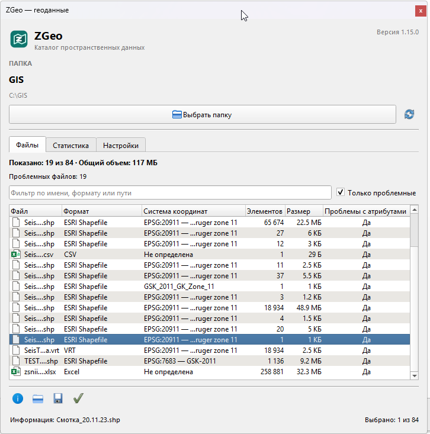
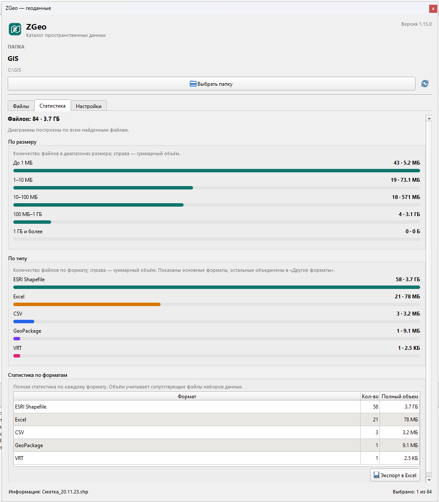
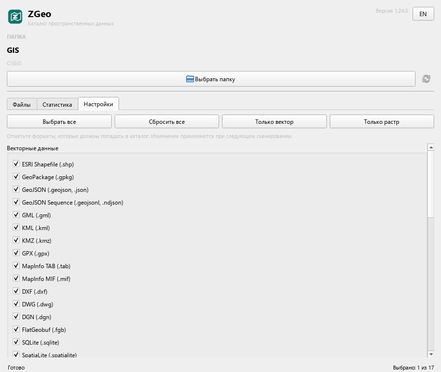

# ZGeo

**Language:** [Русский](README.md) | **English**

A QGIS plugin for quickly browsing the contents of a spatial data folder.

Plugin version: **1.17.0**

The plugin adds a dedicated **“ZGeo”** toolbar to QGIS with a **“ZGeo Catalog”** button that opens a floating panel. The panel provides:

- the plugin version is shown at the top;
- the **“EN” / “RU”** button in the top-right corner switches the interface between English and Russian without restarting QGIS; the selected language is saved;
- the **“Select folder”** button opens the system folder picker;
- the selected folder name and full path are shown at the top of the panel;
- all supported spatial files are found recursively, including subfolders;
- while scanning, the current file name and the number of supported spatial files found are shown, and the **“Cancel”** button stops the scan;
- results are displayed as a list: relative path, format, coordinate reference system, feature count and file size;
- after scanning, the CRS, feature count and full dataset size are read automatically; progress is shown in the status bar;
- the number of files and their total size are shown above the list; when filtering, the total size is calculated for visible files only;
- the full dataset size includes sidecar files (SHP + DBF + SHX + PRJ + CPG and others, MIF + MID, TAB + DAT/MAP/ID/IND);
- the status bar is at the bottom of the window: the current operation is shown on the left, and **“Selected: N of M”** is shown on the right;
- the list can be filtered by name, format, path or attribute issues;
- the **“Settings”** tab lets you select the formats to scan; the **“Select all”**, **“Clear all”**, **“Vector only”** and **“Raster only”** buttons are available at the top; **Excel** is disabled by default;
- the **“Files”** tab has the **“Information”**, **“Open in Explorer”**, **“Export to Excel”** and **“Check attributes”** buttons at the bottom;
- **“Check attributes”** opens the **“Data checks”** window with a list of checks: **“Attribute field name check”** and **“Refine characteristics and sizes”**; checks are enabled with checkboxes, and an **“i”** button to the right of each check shows its description on hover;
- the attribute field name check adds an **“Attribute issues”** column with the values **“Yes”**, **“No”** or **“—”**;
- after the attribute check, the **“Problem files: N”** line is shown and the **“Only problem files”** filter becomes available;
- reading characteristics and the attribute check can be interrupted with the cancel button;
- for a selected file, the panel shows the CRS, feature count, geometry, extent and an attribute field table with names, aliases, types, lengths, precision and comments;
- **“Open in Explorer”** opens Windows Explorer with the file selected; files from different folders open in separate Explorer windows;
- the **“Statistics”** tab shows charts by file size and type, followed by a statistics table by format; after reading characteristics, full dataset sizes are used;
- the file list, statistics table and attribute field table can be exported to Excel; when exporting the list, format statistics are added as a separate worksheet, totals are added to the list and statistics, and Explorer opens with the selected file after saving; if the **“Attribute issues”** column has been added, it is included in the export as well;
- the refresh button rescans the current folder.

QGIS 3.16 and newer are supported, including QGIS 4 / Qt 6.

> The interface is available in Russian and English. Use the **“EN” / “RU”** button in the top-right corner of the panel to switch languages. Documentation is available in both languages.

## Screenshots

### Files tab

Attribute check results, the problematic file counter and the **“Only problem files”** filter.



### Statistics tab

Charts by file size and type, plus the statistics table by format.



### Settings tab

Format selection for scanning and quick-selection buttons.



## Installing in QGIS

### From a ZIP archive

Build the archive:

```powershell
powershell -ExecutionPolicy Bypass -File .\scripts\build_zip.ps1
```

The ready file will be created at `dist\zgeo-1.17.0.zip`. In QGIS, open:

**Plugins → Manage and Install Plugins → Install from ZIP**

and select the built archive.

### Manually

Copy the entire `zgeo` folder to the QGIS plugins directory:

- Windows QGIS 4: `%APPDATA%\QGIS\QGIS4\profiles\default\python\plugins\`
- Windows QGIS 3: `%APPDATA%\QGIS\QGIS3\profiles\default\python\plugins\`
- Linux: `~/.local/share/QGIS/QGIS4/profiles/default/python/plugins/`
- macOS: `~/Library/Application Support/QGIS/QGIS4/profiles/default/python/plugins/`

Then enable **ZGeo** in the QGIS plugin manager.

After updating the plugin, close QGIS completely and start it again. If the **“ZGeo”** toolbar does not appear, open **Plugins → Manage and Install Plugins**, find **ZGeo** and make sure it is enabled.

## Usage

1. Click **“ZGeo Catalog”** on the **“ZGeo”** toolbar (or choose **Plugins → ZGeo → ZGeo Catalog**).
2. If needed, switch the language with the **“EN” / “RU”** button in the top-right corner of the panel.
3. In the floating panel, click **“Select folder”**.
4. Select a folder with geodata.
5. During scanning, the current file name and the number of supported files found are shown. The scan can be stopped with **“Cancel”**.
6. When scanning finishes, the folder name appears at the top and the found files are shown in the list. The CRS, feature count and full dataset size are read automatically; progress is visible in the status bar, and the cancel button can interrupt reading. If needed, enter part of a file name or format in the filter field.
7. Open the **“Settings”** tab to choose the formats to scan. **Excel** is disabled by default; after changing the settings, rescan the folder with the refresh button.
8. Click **“Check attributes”** and select the required checks in the **“Data checks”** window: **“Attribute field name check”** and/or **“Refine characteristics and sizes”**. The description of each check is shown when you hover over the **“i”** button. After the attribute check, the **“Problem files: N”** line appears and the **“Only problem files”** filter becomes available.
9. Select a file and click **“Information”** at the bottom of the list.
10. Click **“Open in Explorer”** to show the file in Windows Explorer.
11. Click **“Export to Excel”** to export the found files with a total row and a separate statistics worksheet. After saving, Explorer opens with the selected `.xlsx`.
12. Open the **“Statistics”** tab to view the charts.

The last selected folder is remembered and used as the starting folder next time.

## Status bar

The status bar is at the bottom of the window. The current operation is shown on the left: scanning, reading characteristics and sizes, attribute check, retrieving information, opening Explorer, Excel export, cancellation messages and errors. The number of selected rows is always shown on the right: **“Selected: N of M”**. The counter is updated when files are selected and when the list is filtered.

## Interface language

The **“EN” / “RU”** button in the top-right corner of the panel switches all labels, tooltips, status bar messages, table headers, dialogs and Excel worksheet names. The selected language is saved in QGIS settings and applied on the next launch. You can switch languages during scanning, reading characteristics or the attribute check — the current operation is not interrupted.

## Scanning

Scanning runs in a background thread, so the QGIS interface remains responsive. While scanning, the panel shows the current file name and the number of files matching the supported spatial formats. Unsupported files do not increment the **“Found”** counter. **“Cancel”** stops the scan; already found files remain in the list, and statistics are built from the partial result.

After the list appears, the panel reads the CRS and feature count one file at a time through QGIS providers. The values appear in the **“CRS”** and **“Features”** columns; the current file and overall progress are shown in the status bar. A cancel button appears next to the buttons at the bottom and interrupts long reads; values already read are kept. For raster files, the feature count is not calculated and **“—”** is shown. If a dataset has multiple layers, feature counts are summed, and if their CRSs differ, **“Mixed”** is shown in the column.

## Format settings

The **“Settings”** tab lists all supported formats with checkboxes, grouped by category. Checked formats are included in the next scan. Settings are saved between QGIS sessions.

The following quick-selection buttons are available at the top of the tab:

- **“Select all”** — select all formats, including Excel;
- **“Clear all”** — clear all selections;
- **“Vector only”** — keep only vector formats selected;
- **“Raster only”** — keep only raster formats selected.

After a button is clicked, the settings are saved immediately. Changes, like manual checkbox changes, are applied on the next scan.

**Excel** (`.xls`, `.xlsx`) is disabled by default. If enabled, Excel tables will be included in the catalog. After changing the settings, click the refresh button at the top of the panel to rescan the folder.

## File information

The **“Information”** button is available when exactly one file is selected in the list. For vector data, the dialog shows:

- file name, format, size and full path;
- layer name and coordinate reference system;
- feature count, geometry type, extent and QGIS provider;
- an attribute field table: name, alias, type, length, precision and comment.

For GeoPackage and other multi-layer containers, a layer selector appears at the top of the dialog. For raster files, the CRS, raster dimensions, band count, pixel size and extent are shown.

Below the attribute field table is the **“Export to Excel”** button. It saves the current layer fields to an `.xlsx` file and opens Explorer with the file selected.

## Data checks

The **“Check attributes”** button at the bottom of the **“Files”** tab opens the **“Data checks”** window. You can enable the attribute field name check, refinement of characteristics and sizes, or both checks at once. To the right of each check is an **“i”** button; hover over it to see the check description.

The attribute field name check iterates over vector files. If a field name contains non-Latin characters (for example, Cyrillic), the new **“Attribute issues”** column is set to **“Yes”**. If the fields contain only Latin characters, digits and common separators, **“No”** is shown. For raster files and files without vector fields, **“—”** is shown.

The column appears after the first check. Check progress is shown in the status bar. If the column has already been added, it is also included in the file list export.

After the check finishes, the **“Problem files: N”** line is shown above the list, and the **“Only problem files”** checkbox becomes available below the search field. It leaves only files with the **“Yes”** value in the table and can be combined with the text filter. If the check was interrupted, the results already obtained are kept, and the counter tooltip shows how many files were processed.

The check can be interrupted with the cancel button next to **“Check attributes”**. After cancellation, reading characteristics resumes automatically. Refinement of characteristics and sizes can be run separately by clearing the attribute field name check checkbox.

## File list export

The **“Export to Excel”** button at the bottom of the **“Files”** tab saves the current list to `.xlsx`. The file contains the **“File”**, **“Format”**, **“CRS”**, **“Features”** and **“Size”** columns. If the **“Attribute issues”** column has been added, it is exported as well. If a filter is enabled, only visible rows are exported to the **“Files”** worksheet.

A blank row and a total are added at the end of the table: **“Total files: N”**, the total feature count and the total size. If the feature count for some files has not been read yet or is undefined, the total cell shows **“—”**.

A separate **“Statistics”** worksheet is created in the same workbook with the **“Format”**, **“Count”** and **“Full size”** columns. It is built from all found files, like the table on the **“Statistics”** tab, and ends with an **“Total”** row containing the total file count and size. After a successful save, Windows Explorer opens with the selected `.xlsx` file.

## Full dataset size

The full size of each dataset is calculated automatically together with the CRS and feature count. Refinement is also available as a separate **“Refine characteristics and sizes”** check in the **“Data checks”** window. The following sidecar files are included:

- Shapefile: `.shp`, `.dbf`, `.shx`, `.prj`, `.cpg`, `.qix`, `.sbn`, `.sbx`, `.fbn`, `.fbx`, `.ain`, `.aih`, `.atx`, `.ixs`, `.mxs`, `.fix`, `.shp.xml`;
- MapInfo MIF: `.mif` + `.mid`;
- MapInfo TAB: `.tab`, `.dat`, `.map`, `.id`, `.ind`;
- CSV: `.csvt`, `.prj`;
- rasters: world files `.tfw`/`.wld`, `.prj`, `.aux.xml` and `.ovr` (for supported raster formats).

During processing, the status bar shows the number of processed files and the current file name. The size in the table is updated as reading progresses. When finished, the total size in the summary and the **“Statistics”** tab are updated. Row selection and the active filter are preserved.

## Opening in Explorer

The **“Open in Explorer”** button is available for one or more selected files. Windows Explorer opens with the file selected. If the selected files are in different folders, a separate Explorer window opens for each folder. If several files in the same folder are selected, the window opens with the first one.

## Statistics

After each scan, two charts and a table are updated on the **“Statistics”** tab:

- **“By size”** — the number of files in the ranges up to 1 MB, 1–10 MB, 10–100 MB, 100 MB–1 GB and 1 GB or more. The total size of files in the range is shown on the right.
- **“By type”** — the number of files by format. The total size is shown on the right; when there are many formats, rare ones are combined into **“Other formats”**.
- **“Statistics by format”** — a complete table with the **“Format”**, **“Count”** and **“Full size”** columns. Unlike the chart, the table shows each format separately.

The charts and table are built from all found files and do not depend on the list filter. After automatic reading of characteristics, statistics use full dataset sizes including sidecar files.

Below the format table is the **“Export to Excel”** button. The `.xlsx` file contains the **“Format”**, **“Count”** and **“Full size”** columns, and an **“Total”** row with the total file count and size is added at the end. After saving, Explorer opens with the file selected.

## Supported formats

| Category | Extensions |
|----------|------------|
| Vector | `.shp`, `.gpkg`, `.geojson`, `.json`, `.geojsonl`, `.ndjson`, `.gml`, `.kml`, `.kmz`, `.gpx`, `.tab`, `.mif`, `.dxf`, `.dwg`, `.dgn`, `.fgb`, `.sqlite`, `.spatialite`, `.osm`, `.pbf`, `.parquet`, `.arrow` |
| Raster | `.tif`, `.tiff`, `.cog`, `.img`, `.asc`, `.dem`, `.hgt`, `.jp2`, `.ecw`, `.sid`, `.bil`, `.bsq`, `.bip`, `.nc`, `.hdf`, `.h5`, `.grib`, `.grb`, `.grib2` |
| Tables | `.csv`, `.tsv`, `.xls`, `.xlsx` |
| Other | `.vrt`, `.mbtiles`, `.pmtiles` |

Dataset sidecar files (`.dbf`, `.shx`, `.prj`, `.shp.xml` and similar) are not displayed as separate rows. The extension list is defined in `scanner.py` and is easy to extend.

## Project structure

```text
zgeo/
├── __init__.py          # classFactory entry point
├── README.md            # Russian documentation
├── README_eng.md        # English documentation
├── metadata.txt         # QGIS plugin metadata
├── plugin.py            # toolbar button and panel lifecycle
├── panel.py             # floating panel, file list and statistics tab
├── i18n.py              # translation dictionary and language switching
├── scanner.py           # scanning, formats and format groups
├── scan_task.py         # background scanning with progress and cancellation
├── dataset_size.py      # full dataset size and sidecar files
├── stats.py             # aggregation by size and format
├── charts.py            # bar charts without external dependencies
├── attribute_check.py   # field name check for non-Latin characters
├── file_info.py         # file, CRS and feature information
├── info_dialog.py       # Information dialog
├── check_dialog.py      # check selection window and descriptions
├── explorer.py          # opening files in Explorer
├── formatting.py        # size formatting
├── excel_export.py      # writing tables to .xlsx without external dependencies
├── table_export.py      # Excel table save dialog
├── icon.svg             # plugin icon
├── img/
│   ├── screen_1.png     # Files tab screenshot
│   ├── screen_2.png     # Statistics tab screenshot
│   └── screen_3.png     # Settings tab screenshot
├── scripts/
│   └── build_zip.ps1    # builds the installation ZIP
└── tests/
    ├── test_scanner.py        # scanner tests
    ├── test_dataset_size.py   # full dataset size
    ├── test_stats.py          # statistics aggregation tests
    ├── test_explorer.py       # grouping files by folder
    ├── test_formatting.py     # size formatting
    ├── test_attribute_check.py # field name check
    ├── test_excel_export.py   # XLSX generation
    └── test_i18n.py           # translations and language switching
```

## Development

The basic tests do not require QGIS or PyQt:

```powershell
cd zgeo
python -m unittest discover -s tests -t .. -v
```

Syntax check:

```powershell
python -m py_compile __init__.py plugin.py panel.py i18n.py scanner.py scan_task.py dataset_size.py stats.py charts.py attribute_check.py file_info.py info_dialog.py check_dialog.py explorer.py formatting.py excel_export.py table_export.py version.py
```

Scanning runs in a background thread. For very large directories on network drives, the list may fill gradually, but the interface remains responsive and the scan can be interrupted.

---

**Language:** [Русский](README.md) | **English**
