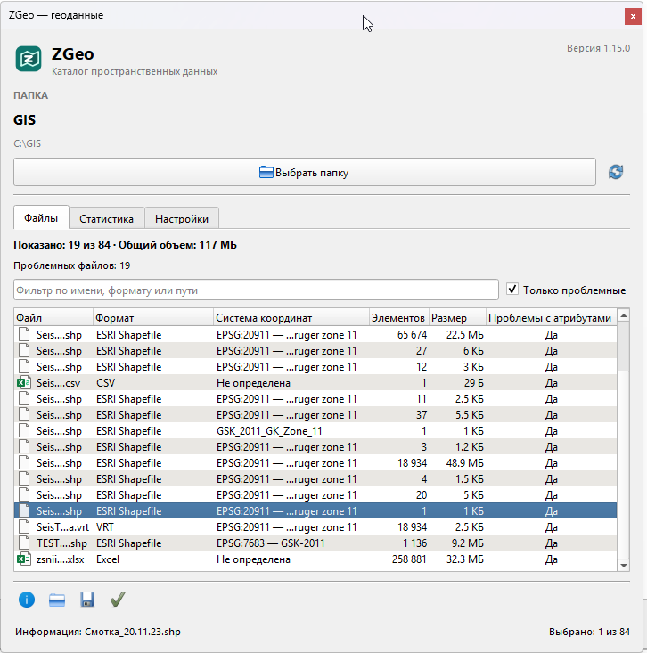
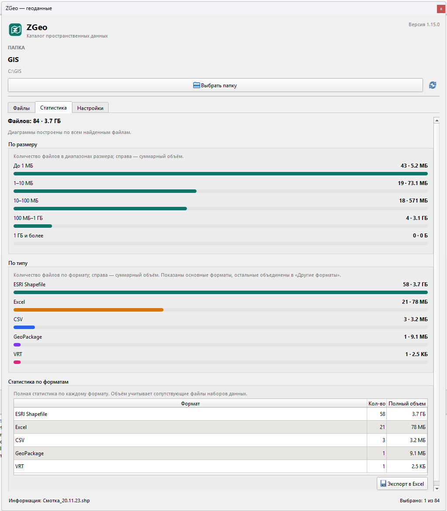
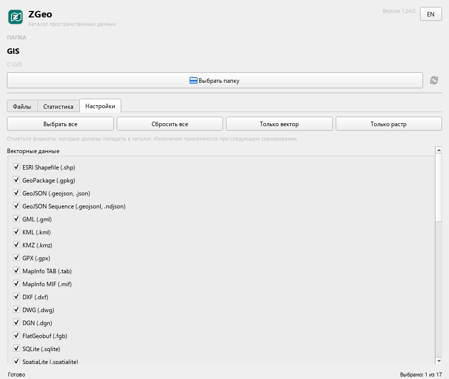
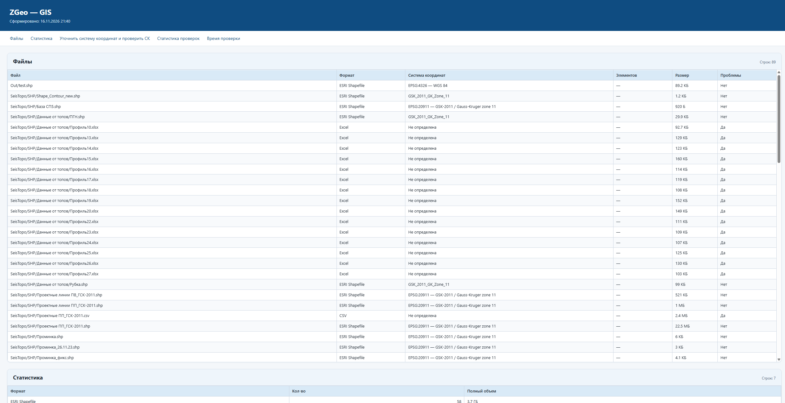

# ZGeo

**Language:** [Русский](README.md) | **English**

A QGIS plugin for quickly browsing the contents of a spatial data folder.

> **Tested:** the plugin has been tested in QGIS on Windows. It has not been tested on other operating systems (macOS, Linux).

The plugin adds a dedicated **“ZGeo”** toolbar to QGIS with a **“ZGeo Catalog”** button that opens a floating panel. The panel provides:

- the plugin version is shown at the top;
- the **“EN” / “RU”** button in the top-right corner switches the interface between English and Russian without restarting QGIS; the selected language is saved;
- the **“Select folder”** button opens the system folder picker;
- the selected folder name and full path are shown at the top of the panel;
- all supported spatial files are found recursively, including subfolders;
- while scanning, the current file name and the number of supported spatial files found are shown, and the **“Cancel”** button stops the scan;
- results are displayed as a list: relative path, format, coordinate reference system, feature count and file size;
- after scanning, the CRS, feature count and full dataset size are not read automatically; use the **“Spatial data quality”** and **“Attribute data quality”** tabs to refine them, with progress shown in the status bar and on the progress bar;
- the number of files and their total size are shown above the list; when filtering, the total size is calculated for visible files only;
- the full dataset size includes sidecar files (SHP + DBF + SHX + PRJ + CPG and others, MIF + MID, TAB + DAT/MAP/ID/IND);
- the status bar is at the bottom of the window: the current operation is shown on the left, and **“Selected: N of M”** is shown on the right; during scanning and checks, a full-width progress bar with the current and total file counts is shown below the status bar, with only the current check name above it;
- the list can be filtered by name, format, path or issues;
- the **“Settings”** tab lets you select the formats to scan; the **“Select all”**, **“Clear all”**, **“Vector only”** and **“Raster only”** buttons are available at the top; **Excel** is disabled by default;
- the **“Files”** tab has the **“Information”**, **“Open in Explorer”**, **“Copy to …”**, the small **“Add to current project”** button, **“Checks”** and **“Export”** buttons at the bottom; **“Export”** opens a choice of Excel or HTML;
- after the first scan, the **“Spatial data quality”** and **“Attribute data quality”** tabs become available; they are disabled before the first scan; **“Checks”** opens the **“Spatial data quality”** tab; checks are divided between the tabs by meaning, enabled with checkboxes, and an **“i”** button to the right of each check opens a panel with a detailed description, the actions performed and examples; by default, **“Refine size”**, **“Refine CRS and check it”**, **“Refine feature count”**, the JSON check and the field name check are selected; the file readability, field name duplicates, attribute completeness, empty fields, control and invisible characters, attribute duplicates, blank strings, leading and trailing spaces, double spaces inside values, numbers stored as text, mixed types in a field, abnormal text length, dates outside a reasonable range, suspicious field names, text encoding, extension and content mismatch, attribute and geometry duplicates, GeoPackage/SQLite integrity and topology checks are optional;
- the JSON check appears when the list contains `.json` or `.geojson` files; it validates the document by its `type` field and excludes files that are not GeoJSON; the optional **“GeoJSON check”** validates coordinates, ring closure, `bbox` and `Feature`/`GeometryCollection` structure;
- **“Attribute completeness check”** finds NULLs, empty strings and whitespace-only strings, calculates fill rates by field, required fields and almost empty layers; **“Empty fields (100% NULL)”** finds columns whose values are all NULL or empty strings and that have nothing to export; **“Mixed types in a field”** finds text columns where numbers and text occur together; **“Topology check”** finds polygon overlaps and gaps, dangling lines and line intersections;
- problems found are shown in the **“Issues”** column with the values **“Yes”**, **“No”** or **“—”**; details are available in the cell tooltip;
- after the checks, the **“Problem files: N”** line is shown and the **“Only problem files”** filter becomes available;
- data refinement, the JSON check and problem checks can be interrupted with the cancel button;
- for a selected file, the panel shows the CRS, feature count, geometry, extent and an attribute field table with names, aliases, types, lengths, precision and comments;
- **“Open in Explorer”** opens Windows Explorer with the file selected; files from different folders open in separate Explorer windows;
- **“Copy to …”** copies the selected datasets together with their sidecar files to a chosen folder, shows progress and can be cancelled; if the folder already contains files with the same names, the plugin asks for confirmation before replacing them, and after a successful copy it opens Explorer in the destination folder;
- the **“Statistics”** tab shows charts by file size and type, followed by a statistics table by format; after size refinement, full dataset sizes are used;
- the file list, statistics table and attribute field table can be exported to Excel, and the full file-list report can also be exported to standalone HTML; the format is selected in the **“Export”** menu; when exporting the list, format statistics are added as a separate worksheet, totals are added to the list and statistics, and Explorer opens with the selected file after saving; if the **“Issues”** column has been added, it is included in the export as well; for completed checks, the report also includes operation time and throughput in files per second and per minute;
- the refresh button rescans the current folder.

QGIS 3.16 and newer are supported, including QGIS 4 / Qt 6.

> The interface is available in Russian and English. Use the **“EN” / “RU”** button in the top-right corner of the panel to switch languages. Documentation is available in both languages.

## Screenshots

### Files tab

Problem check results, the **“Issues”** column, the problematic file counter and detail tooltips.



### Statistics tab

Charts by file size and type, plus the statistics table by format.



### Settings tab

Format selection for scanning and quick-selection buttons.



### HTML report

A standalone HTML report with check tabs, format statistics and check timing.



## Installing in QGIS

### From a ZIP archive

Build the archive:

```powershell
powershell -ExecutionPolicy Bypass -File .\scripts\build_zip.ps1
```

The ready file will be created at `dist\zgeo-1.18.0.zip`. In QGIS, open:

**Plugins → Manage and Install Plugins → Install from ZIP**

and select the built archive.

### Manually

Copy the entire `zgeo` folder to the QGIS plugins directory:

- Windows QGIS 4: `%APPDATA%\QGIS\QGIS4\profiles\default\python\plugins\`
- Windows QGIS 3: `%APPDATA%\QGIS\QGIS3\profiles\default\python\plugins\`
- Linux: `~/.local/share/QGIS/QGIS4/profiles/default/python/plugins/`
- macOS: `~/Library/Application Support/QGIS/QGIS4/profiles/default/python/plugins/`

Then enable **ZGeo** in the QGIS plugin manager.

After updating the plugin, close QGIS completely and start it again. If the **“ZGeo”** toolbar does not appear, open **Plugins → Manage and Install Plugins**, find **ZGeo** and make sure it is enabled.

## Usage

1. Click **“ZGeo Catalog”** on the **“ZGeo”** toolbar (or choose **Plugins → ZGeo → ZGeo Catalog**).
2. If needed, switch the language with the **“EN” / “RU”** button in the top-right corner of the panel.
3. In the floating panel, click **“Select folder”**.
4. Select a folder with geodata.
5. During scanning, the current file name and the number of supported files found are shown. The scan can be stopped with **“Cancel”**.
6. When scanning finishes, the folder name appears at the top and the found files are shown in the list. The CRS and feature count show **“—”** until checks are run. If needed, enter part of a file name or format in the filter field.
7. Open the **“Settings”** tab to choose the formats to scan. **Excel** is disabled by default; after changing the settings, rescan the folder with the refresh button.
8. After the first scan, open the **“Spatial data quality”** or **“Attribute data quality”** tab (**“Checks”** opens the spatial tab) and select the required checks. The spatial tab includes size refinement, file readability, CRS refinement and checking, feature count refinement, JSON and GeoJSON, file names and paths, dataset integrity, GeoPackage/SQLite integrity, metadata and CRS, PRJ, geometry, topology, duplicate features and coordinate checks. The attribute tab includes field name, field name duplicates, attribute completeness, empty fields, control and invisible character, attribute duplicate, blank string, leading/trailing space, double space, numbers stored as text, mixed types in a field, abnormal text length, dates outside a reasonable range, suspicious field names, text encoding, extension/content mismatch and attribute/geometry duplicate checks. The **“i”** button opens a panel on the right with a detailed description of the check, what will be done and examples. The **“Select all”**, **“Clear all”** and **“Defaults”** buttons change the marks for the whole tab at once. Click **“Run selected checks”**. If the list contains `.json` or `.geojson`, the JSON check excludes files that are not GeoJSON. After the checks, the **“Problem files: N”** line and the **“Issues”** column appear, and the **“Only problem files”** filter becomes available.
9. Select a file and click **“Information”** at the bottom of the list.
10. Click **“Open in Explorer”** to show the file in Windows Explorer.
11. If needed, select one or more files and click **“Copy to …”** to copy the datasets with their sidecar files to another folder. To open the selected files as layers in the current project, click the small **“Add to current project”** button.
12. Click **“Export”** and choose **Excel** or **HTML** to export the found files with a total row and statistics. After saving, Explorer opens with the selected `.xlsx` or `.html`.
13. Open the **“Statistics”** tab to view the charts.

The last selected folder is remembered and used as the starting folder next time.

## Status bar

The status bar is at the bottom of the window. The current operation is shown on the left: scanning, size, CRS or feature count refinement, JSON check, problem checks, retrieving information, opening Explorer, copying files, Excel or HTML export, cancellation messages and errors. The number of selected rows is always shown on the right: **“Selected: N of M”**. The counter is updated when files are selected and when the list is filtered.

During scanning and long-running checks, a full-width progress bar appears below the status bar: while scanning it shows indeterminate progress, and during checks it shows how many files have been processed out of the total. Only the current check or operation name is displayed above the progress bar. The progress bar and its title are hidden when the operation finishes.

## Interface language

The **“EN” / “RU”** button in the top-right corner of the panel switches all labels, tooltips, status bar messages, table headers, dialogs, Excel worksheet names and HTML section titles. The selected language is saved in QGIS settings and applied on the next launch. You can switch languages during scanning, data refinement or problem checks — the current operation is not interrupted.

## Scanning

Scanning runs in a background thread, so the QGIS interface remains responsive. While scanning, the panel shows the current file name and the number of files matching the supported spatial formats. Unsupported files do not increment the **“Found”** counter. **“Cancel”** stops the scan; already found files remain in the list, and statistics are built from the partial result.

After the list appears, the **“CRS”** and **“Features”** columns contain **“—”**: values are not read automatically. Open the **“Spatial data quality”** tab (**“Checks”**) or the **“Attribute data quality”** tab and select the required checks. The panel processes files one at a time through QGIS providers; the current file and overall progress are shown in the status bar. A cancel button appears next to the buttons at the bottom and interrupts the long operation; values already obtained are kept. For raster files, the feature count is not calculated and **“—”** is shown. If a dataset has multiple layers, feature counts are summed, and if their CRSs differ, **“Mixed”** is shown in the column.

## Format settings

The **“Settings”** tab lists all supported formats with checkboxes, grouped by category. Checked formats are included in the next scan. Settings are saved between QGIS sessions.

The following quick-selection buttons are available at the top of the tab:

- **“Select all”** — select all formats, including Excel;
- **“Clear all”** — clear all selections;
- **“Vector only”** — keep only vector formats selected;
- **“Raster only”** — keep only raster formats selected.

After a button is clicked, the settings are saved immediately. Changes, like manual checkbox changes, are applied on the next scan.

**Excel** (`.xls`, `.xlsx`) is disabled by default. If enabled, Excel tables will be included in the catalog. After changing the settings, click the refresh button at the top of the panel to rescan the folder.

## File information

The **“Information”** button is available when exactly one file is selected in the list. For vector data, the dialog shows:

- file name, format, size and full path;
- layer name and coordinate reference system;
- feature count, geometry type, extent and QGIS provider;
- an attribute field table: name, alias, type, length, precision and comment.

For GeoPackage and other multi-layer containers, a layer selector appears at the top of the dialog. For raster files, the CRS, raster dimensions, band count, pixel size and extent are shown.

Below the attribute field table is the **“Export to Excel”** button. It saves the current layer fields to an `.xlsx` file and opens Explorer with the file selected.

## Checks

After the first scan, two tabs become available in the main window. They are disabled before the first scan. Checks are divided between them by meaning.

**“Spatial data quality”** — the **“Checks”** button at the bottom of the **“Files”** tab opens this tab. It contains:

- **“Refine size”** — full size of each dataset, including sidecar files; it covers all formats, including SHP and MIF/MID;
- **“File readability check”** — opens every file through QGIS providers, checks that layers are available and reads one feature from each vector layer or a small raster sample; missing and empty files, open errors and read errors are flagged;
- **“Refine CRS and check it”** — reads the CRS, fills the “CRS” column and flags missing, unknown or mixed CRSs;
- **“Refine feature count”** — counts features and fills the “Features” column for every layer of the file; the check only refines data and does not flag files as problematic;
- **“Check JSON for GeoJSON format”** — validates `.json` and `.geojson` files by the `type` field; files that are not GeoJSON are excluded from the list;
- **“GeoJSON check”** — coordinates (NaN/Inf, longitude and latitude range, swapped axes), ring closure and minimum point count, `bbox`, and the structure of `Feature`, `FeatureCollection` and `GeometryCollection`;
- **“File name and path check”** — a full path longer than 260 characters, invalid and reserved names, names that differ only by case, and orphaned sidecar files;
- **“Dataset integrity check”** — required files: `.shp` + `.dbf` + `.shx`, `.mif` + `.mid`, `.tab` + `.dat/.map/.id`, plus the presence of `.cpg` and the DBF encoding;
- **“GeoPackage/SQLite integrity check”** — `PRAGMA quick_check` and, on errors, `PRAGMA integrity_check`, `PRAGMA foreign_key_check`, required GeoPackage tables, table and geometry column existence, SRS references and `srs_id` consistency;
- **“Metadata and CRS check”** — missing `.prj` and `.cpg` on SHP, `.aux.xml` and `.ovr` on rasters, a `.tfw/.tifw/.wld` world file when no CRS is present, deprecated CRS, CRS without an EPSG/authority code, non-metric units and non-standard axis order;
- **“PRJ file check”** — the presence of a `.prj` (or `.qpj`) file, its readability, an empty file, WKT validity and whether the CRS type and EPSG code match the layer CRS;
- **“Geometry validity check”** — self-intersections, unclosed rings, empty and null geometries;
- **“Topology check”** — polygon overlaps by area, enclosed gaps between polygons, dangling line endpoints, interior line intersections and line overlaps;
- **“Attribute and geometry duplicates”** — features where both all attribute values and the geometry match. Separate checks find duplicates by geometry only and by attributes only; here complete copies of one record are reported, which double sums and areas and produce double labels on the map.
- **“Duplicate features check”** — features with completely identical geometry (byte-for-byte WKB comparison: type, vertex count and all coordinates, including Z);
- **“Coordinate check”** — NaN/Inf, excessively large values, swapped latitude and longitude, and coordinates outside the valid CRS range.

**“Attribute data quality”** — this tab contains:

- **“Field name check”** — non-Latin characters, name length (10 characters max for DBF), spaces, invalid characters and duplicates after truncation;
- **“Field name duplicates check”** — attribute field names that match ignoring case within the same layer;
- **“Attribute completeness check”** — NULLs, empty strings and whitespace-only strings, fill rate by field, required fields with empty values, fields below 50% fill and almost empty layers;
- **“Empty fields (100% NULL)”** — columns whose values are all NULL or empty strings. Such fields have nothing to export, take up space in the schema and can break data exchange;
- **“Control and invisible characters”** — tab, line feed, carriage return, vertical tab, form feed, NUL and ESC, plus no-break and zero-width spaces, the soft hyphen, line and paragraph separators, the byte order mark and other Unicode format characters in text values. A regular space is not a problem; the report shows the character names, the number of features and a sample value with \t, \n and \uXXXX escapes;
- **“Attribute duplicates (very slow!)”** — full row duplicates (every attribute column matches), composite key duplicates (every text column matches), matches ignoring case and extra spaces (“Москва” and “москва ”), and partial occurrences where a value is fully contained in another value of the same field, with the occurrence percent. Double-clicking a results table cell opens the detailed list with percentages. The check reads every feature and compares values pairwise, so it runs very long on large datasets.
- **“Blank strings”** — text fields whose value is empty or consists only of spaces. For the user such values are indistinguishable from NULL, but they behave differently in queries: `IS NULL` does not find them, and sorting and grouping produce a separate group; the report shows the count and share of blank strings per field.
- **“Leading and trailing spaces”** — values with leading or trailing spaces, tabs and line breaks. Such values do not match in comparisons and joins (“Москва” and “Москва ” are considered different), which breaks dictionaries, filters and relations between layers; the report shows how many values have leading and how many trailing spaces, plus a sample with visible symbols (“·Москва·”, “\tТверь”).
- **“Double spaces inside values”** — values containing two or more consecutive spaces. This is usually the result of manual input or field concatenation: such records are not found by an exact value search and look untidy in reports; the report shows the number of features, the share and a sample with visible spaces (“Москва··Сити”).
- **“Numbers stored as text”** — text columns whose values are numbers (identifiers, areas, codes). Because of the text type the comparison is alphabetical (“10” is less than “9”) and arithmetic operations are impossible; the report shows the number of features, the share, how many values are integer and how many are real, and a sample.
- **“Mixed types in a field”** — text columns where numbers and text occur together, for example “10”, “20” and “N/A”. Excel and SQL may determine the type of such a column differently: some values become numbers and some remain text, which breaks sorting, sums, filters, Excel import and SQL queries; the report shows the number of numeric and text values, their shares and samples.
- **“Text encoding (mojibake)”** — values that look like text read with the wrong encoding: `МоÑква` instead of `Москва`. Such values appear when a file is saved with the wrong encoding or UTF-8 is read as a single-byte encoding; they cannot be found by search and break sorting and comparison with reference values. The report shows the number of features, the share, a sample and the repaired text when it could be restored.
- **“Abnormal text length”** — for every text column the average value length and the standard deviation are computed, and values longer than the average by more than three deviations are flagged. This finds truncated dictionary fields and, conversely, values with concatenated or extra text; the report shows the average, the deviation, the longest length, the features and a sample.
- **“Dates outside a reasonable range”** — dates and timestamps earlier than 1900 and later than the current year. This is how dates written in a wrong format and the result of a zero-date substitution look: such values break time filters and the chronology in reports. The report shows the number of features, the share, the minimum and maximum year found and the values themselves.
- **“Suspicious field names”** — technical names produced by an import (`Field1`, `field_2`, `Column3`, `Unnamed: 0`), names that mean a missing value (`NULL`, `None`, `NaN`), names made of digits only and an empty name. They are not in the dictionary, so the layer cannot be matched to the reference schema and reports and labels get meaningless headings.

Above the check list on each tab are **“Select all”** — mark every check on the tab, **“Clear all”** — clear every mark, and **“Defaults”** — restore the default selection. The check list itself scrolls, so the tab can be made shorter without losing access to the buttons. The **“Run selected checks”** button sits on the right above the results table, where the export buttons used to be.

A results table cell with findings is highlighted in pink, while a cell without problems stays plain. The legend **“Pink cells mean problems were found”** sits next to the table title.

Below the list a results table is filled in: rows are the found files (relative path) and columns are the statistics of each selected check. For problem checks a cell shows the number of findings (zero means no problems, a dash means the check does not apply to the file); for **“Refine size”** it shows the full dataset size, for **“CRS refinement and check”** the detected CRS, and for **“Feature count refinement”** the feature count. The border between the list and the table can be dragged.

Right-click a results table cell and choose **"Load into the current project and show on the map"**. The plugin opens the layer (adding it to the project when missing), selects only the problematic features of that cell, clearing the previous selection, zooms the map to their extent and opens the layer attribute table. This command does not open Explorer: findings without features are skipped and counted in the status bar, and only a `.prj` finding opens the .prj file itself.

Under the results table is an **“Export”** button with the **“Export to Excel”** and **“Export to HTML”** choices. Only the checks shown in the current tab columns are exported. To the right of each check is an **“i”** button; click it to open a panel on the right with a detailed description of the check, what will be done and examples. The panel can be closed with the **“×”** button, and clicking another **“i”** button switches its contents. By default, **“Refine size”**, **“Refine CRS and check it”**, **“Refine feature count”**, **“Check JSON for GeoJSON format”** and **“Field name check”** are selected; the file readability check, the GeoJSON check, the field name duplicates check, the attribute completeness check, the empty fields check, the control and invisible characters check, the attribute duplicates check, the blank strings check, the leading and trailing spaces check, the double spaces check, the numbers stored as text check, the mixed types in a field check, the abnormal text length check, the dates outside a reasonable range check, the suspicious field names check, the text encoding check, the extension and content mismatch check, the attribute and geometry duplicates check, the dataset integrity check, the GeoPackage/SQLite integrity check, the metadata and CRS check, the PRJ file check, the geometry validity check, the topology check, the duplicate features check and the coordinate check are optional. **“Refine size”** covers all formats, including SHP and MIF/MID.

The JSON check appears on the **“Spatial data quality”** tab only when the found files include `.json` or `.geojson`. It reads the document and validates its `type` field: `FeatureCollection`, `Feature`, `GeometryCollection` and the geometry types (`Point`, `MultiPoint`, `LineString`, `MultiLineString`, `Polygon`, `MultiPolygon`) are allowed. For collections, the `features` and `geometries` members are validated as well. If the document is not GeoJSON (for example, a plain JSON object without `type` or with an unknown `type`), the file is excluded from the list and the file count, total size and statistics are recalculated. The JSON check runs before size, CRS and feature count refinement, so the remaining checks work on the already filtered list.

The **“GeoJSON check”** complements the format check and validates the content of `.json` and `.geojson` documents. Coordinates are checked for numeric type, absence of `NaN`/`Inf`, longitude range `[-180, 180]` and latitude range `[-90, 90]`, and signs of swapped axes. Lines and polygons are checked for the minimum point count and ring closure. The optional `bbox` is validated at document, feature, geometry and collection level: a length of 4 or 6 numbers, finite values and minimum/maximum order. Required fields and the structure of `Feature`, `FeatureCollection` and `GeometryCollection` are also checked. The check is disabled by default and appears on the **“Spatial data quality”** tab together with the JSON check when `.json` or `.geojson` files are present.

The **“Attribute completeness check”** works with vector layers and tables and treats `NULL`, empty strings and whitespace-only strings as empty. For each layer it calculates the fill rate of all cells and the share of completely empty features. Fields with a `NOT NULL` constraint and primary key fields are considered required. The check reports required fields with empty values, optional fields below 50% fill and almost empty layers: less than 5% of cells filled or at least 95% of features with no filled attributes. The tooltip shows a per-layer summary, and the report includes the fill rate of every field in problematic layers. The check is disabled by default.

The **“Empty fields (100% NULL)”** check reads every feature of each vector layer and table and flags fields with no filled value at all: every value is `NULL`, an empty string or a whitespace-only string. Such columns have nothing to export: they take up space in the schema, create empty attributes, interfere with required constraints and can break the schema and data exchange. The check only reports problems and does not delete fields. For every such field the report shows the layer, the field name and the number of empty values. The check is disabled by default.

The **“Control and invisible characters”** check reads the text fields of vector layers and tables and looks for control and invisible characters in the values. Control characters are tab (TAB), line feed (LF), carriage return (CR), vertical tab, form feed, NUL, ESC and the other C0 and C1 characters; invisible ones are the no-break and narrow no-break spaces, the soft hyphen, zero-width characters, line and paragraph separators, the byte order mark and other Unicode format characters. A regular space is not a problem. Such characters break the layout of labels and reports, corrupt CSV parsing and prevent string comparison: two visually identical labels turn out to be different. The tooltip shows the names and code points of the found characters, the number of features and a sample value with control characters replaced by \t, \n and \uXXXX. The check is disabled by default.

The **“Attribute duplicates (very slow!)”** check combines four kinds of duplicates. Full row duplicates are features where every attribute column matches. Composite key duplicates are features where every text column of the layer matches. Matches ignoring case and extra spaces are found by lower-casing values and collapsing repeated spaces before comparison, so “Москва” and “москва ” count as duplicates. Partial occurrences are values fully contained in another value of the same field, for example “Yamalo-Nenets autonomous okru” inside “Yamalo-Nenets autonomous okrug”; the occurrence percent is the length of the short value relative to the long one. Duplicates inflate statistics, produce double labels on the map and prevent merging data from different sources. The check reads every feature of a layer and compares values pairwise, so it runs very long on large datasets; to avoid hanging it inspects at most 50 000 features per layer, at most 1000 values per field for partial occurrences and shows at most 200 groups per duplicate kind. The results cell shows the number of duplicates found, and double-clicking it opens the detailed list with percentages. The check is disabled by default.

The **“Blank strings”** check reads the text fields of vector layers and tables and treats as blank the values that are an empty string or consist only of spaces, tabs and line breaks. For the user such values are indistinguishable from NULL, but they behave differently in queries: an `IS NULL` condition does not find them, and sorting and grouping produce a separate group, so the same "emptiness" lands in different places in reports. The tooltip shows a per-layer summary — how many fields are affected and how many blank strings each one has — while the report shows the count and share of blank strings per field. The check only reports problems and does not modify data. The check is disabled by default.

The **“Leading and trailing spaces”** check reads the text fields of vector layers and tables and compares each value with its trimmed version; a space, tab, line feed, carriage return, vertical tab and form feed are counted. Such values do not match in comparisons and joins: “Москва” and “Москва ” are considered different, which breaks dictionaries, filters and relations between layers, and grouping produces extra groups. Values consisting only of spaces are skipped by this check — the “Blank strings” check covers them. The tooltip shows a per-layer summary, while the report shows for every field the number of features, the share, how many values have leading and how many trailing spaces, and a sample value with visible space symbols: “·Москва·”, “\\tТверь”. The check is disabled by default.

The **“Double spaces inside values”** check reads the text fields of vector layers and tables, trims the edge spaces and looks for runs of two or more whitespace characters inside the value. This is usually the result of manual input or field concatenation: such records are not found by an exact value search, look untidy in reports, and a comparison with the normalized value gives a false mismatch. Edge spaces are covered by the separate “Leading and trailing spaces” check and empty values by the “Blank strings” check. The tooltip shows a per-layer summary, while the report shows for every field the number of features, the share and a sample value with spaces replaced by visible symbols: “Москва··Сити”. The check is disabled by default.

The **“Numbers stored as text”** check reads the text fields of vector layers and tables and validates the values: a number consists of digits, at most one decimal separator (a dot or a comma), a sign and an exponent; spaces inside the value, letters and repeated separators make the value non-numeric. This is how fields that should be stored as numbers usually look: identifiers, areas, codes. Because of the text type the comparison is alphabetical (“10” is less than “9”) and arithmetic operations are impossible. Leading zeros do not matter: “007” also counts as a number stored as text. The tooltip shows a per-layer summary, while the report shows for every field the number of features, the share, how many values are integer and how many are real, and a sample. The check is disabled by default.

The **“Mixed types in a field”** check reads the text fields of vector layers and tables and looks for columns where numbers and text occur together: a value counts as a number by the same rules as in the “Numbers stored as text” check, and all other non-empty values count as text; `NULL` and empty strings are ignored. If a column contains both “10” and “N/A”, Excel and SQL may determine the column type differently: some values become numbers and some remain text, which breaks sorting, sums, filters, Excel import and SQL queries. The tooltip shows a per-layer summary, while the report shows for every field the number of numeric and text values, their shares and samples of both kinds. The check only reports problems and does not change the data. The check is disabled by default.

The **“Abnormal text length”** check measures the length of every non-empty value in a text field, computes the average length and the standard deviation, and then flags values longer than the average by more than three deviations. This finds truncated dictionary fields and, conversely, values with concatenated or extra text: a field of two or three words suddenly contains a full address line or several values separated by a delimiter. The check works on lengths only and does not read the content, so the report shows for every field the average, the deviation, the longest length, the features and a sample value. Fields with few values (fewer than three) and fields where every value has the same length produce no findings. The check is disabled by default.

The **“Dates outside a reasonable range”** check reads date, timestamp and text fields, parses the values as dates and flags years earlier than 1900 and later than the current year. The formats YYYY-MM-DD, DD.MM.YYYY, DD/MM/YYYY and YYYY/MM/DD are supported, including a time part after “T” or a space; the zero date 0000-00-00 is reported as well. This is how dates written in a wrong format and the result of a zero-date substitution look: such values break time filters and the chronology in reports, and sorting by date puts them at the beginning or at the end of the list. The tooltip shows a per-layer summary, while the report shows for every field the number of features, the share, the minimum and maximum year found, the features and the values themselves. The check is disabled by default.

The **“Suspicious field names”** check reads the field names of every vector layer and flags an empty name, names that mean a missing value (`NULL`, `None`, `NaN`, `Nil`, `Undefined`), names made of digits only and technical names produced by an import: `Field1`, `field_2`, `Column3`, `Unnamed: 0`, `Attribute1`. Such names appear when tables and text files without headers are imported, when sources are concatenated and after a conversion from Excel: they are not in the dictionary, so the layer cannot be matched to the reference schema and reports and labels get meaningless headings. Meaningful short names (`id`, `code`, `name`, `OBJECTID`) are not reported. For every field the report shows the name and the reason: the name means a missing value, the name is made of digits only, a technical name produced by an import, the field name is empty. The check only reports problems and does not rename fields. The check is disabled by default.

The **“Text encoding (mojibake)”** check reads the text fields of vector layers and tables and tries to encode every value back into a single-byte encoding (latin-1, cp1252, cp1251) and decode it as UTF-8 again. If this produces different meaningful text, the value is treated as mojibake: `МоÑква` instead of `Москва`, `Привет` instead of `Привет`. Such values appear when a file is saved with the wrong encoding or UTF-8 is read as a single-byte encoding; they cannot be found by search, they break sorting and comparison with reference values, and they look like garbage in reports and labels. Ordinary text, Latin letters with diacritics (`ESPAÑA`, `café`) and correctly encoded Cyrillic are not reported. The tooltip shows a per-layer summary, while the report shows for every field the number of features, the share, a sample value and the repaired text when it could be restored. The check only reports problems and does not modify data. The check is disabled by default.

The **“Extension and content mismatch”** check reads the first kilobytes of a file and compares them with the signatures of known formats: SQLite database (GeoPackage, SQLite, SpatiaLite, MBTiles), Shapefile, ZIP (KMZ, XLSX), TIFF (GeoTIFF), JPEG 2000, NetCDF, HDF, Parquet, Arrow, FlatGeobuf, PMTiles, OLE2 (XLS), JSON and XML. This finds files renamed to another format or saved with an error: a "shapefile" that actually contains an Excel table or a ZIP archive, a `.gpkg` without the SQLite header, a `.tif` holding text. QGIS does not show this and either fails to open the file or opens it as an empty layer. Empty and too short files are not covered by this check — the file readability check handles them. The comparison uses the content only and the file is not modified. The check is disabled by default.

The **“Attribute and geometry duplicates”** check compares the features of every vector layer by the pair "all attributes + geometry": attributes are taken as is and the geometry byte by byte as WKB, including type, vertex count and all coordinates. Separate checks find duplicates by geometry only and by attributes only, while here features that match completely are reported: they are copies of one record that ended up in the layer twice. Such duplicates double sums and areas, produce double labels on the map and prevent merging data from different sources. Features with the same geometry but different attributes, and features with the same attributes but different geometry, are not reported by this check — the geometry duplicates and attribute duplicates checks cover them. The tooltip shows the matching pairs and the report shows the number of duplicates and groups. The check does not apply to tables without geometry. The check is disabled by default.

The **“GeoPackage/SQLite integrity check”** opens `.gpkg`, `.sqlite` and `.spatialite` files read-only and runs `PRAGMA quick_check`; if errors are found, `PRAGMA integrity_check` is run as well. Then `PRAGMA foreign_key_check` is executed. For GeoPackage, the required `gpkg_contents`, `gpkg_geometry_columns` and `gpkg_spatial_ref_sys` tables are checked, along with table and geometry column existence, SRS references and `srs_id` consistency between `gpkg_contents` and `gpkg_geometry_columns`. The file is not modified. For ordinary SQLite databases without GeoPackage tables, only integrity and foreign keys are checked. The check is disabled by default.

The **“Topology check”** analyses polygons and lines within each layer. Polygons are checked pairwise for overlaps by area, and the layer union is inspected for enclosed gaps; a gap is reported when its boundary touches two or more features, so interior holes of a single polygon are not considered gaps. For lines, a free endpoint is dangling if it does not coincide with another line endpoint and does not lie on another line. Interior line intersections and line overlaps are reported separately; shared endpoints and T-junctions are considered valid connections. Invalid and empty geometries are skipped because the geometry validity check covers them. Up to 1,000 issues per layer are described in detail. The check is disabled by default.

Problem checks run one after another: the bottom label shows only the current check instead of the full list, and each check is timed separately. They inspect the found files and collect all findings in the **“Issues”** column: **“Yes”** — problems found, **“No”** — no problems found, **“—”** — the check is not applicable to the file. The detailed list of problems is shown in the cell tooltip. “Refine CRS and check it” fills the “CRS” column and flags files without a CRS, with an unknown CRS and files whose layers have different CRSs. “Refine feature count” fills the “Features” column and does not flag files as problematic. “File readability check” opens every file through QGIS providers and flags missing and empty files, open errors and layer read errors. “Field name check” combines non-Latin characters, length, spaces, invalid characters and duplicates after truncation; “Field name duplicates check” finds names that match ignoring case within the same layer. “File name and path check” looks for over-long paths, invalid characters, reserved names, case-insensitive name collisions and sidecar files without a main file. “Dataset integrity check” looks for missing required files, a missing or empty `.cpg` and an unknown DBF encoding. “GeoPackage/SQLite integrity check” validates database integrity, foreign keys, required GeoPackage tables, geometry columns and `srs_id` consistency. “Metadata and CRS check” looks for missing `.prj` and `.cpg` on SHP, `.aux.xml` and `.ovr` on rasters, a `.tfw/.tifw/.wld` world file when no CRS is present, deprecated CRS, CRS without an EPSG/authority code, non-metric units and non-standard axis order. “PRJ file check” parses the `.prj` as WKT and compares the CRS type and EPSG code with the layer. “Geometry validity check” finds self-intersections, unclosed rings, empty and null geometries. “Duplicate features check” compares feature geometry byte by byte and flags complete matches. “Coordinate check” finds NaN/Inf, excessively large values, swapped latitude and longitude, and coordinates outside the valid CRS range; for projected CRSs, points are also checked against the CRS area of use. “GeoJSON check” finds invalid coordinates, unclosed and too-short rings, `bbox` errors and violations of the `Feature`/`GeometryCollection` structure; each reported error includes its path inside the JSON and the feature identifier. “Attribute completeness check” flags empty required fields, fields below 50% fill and almost empty layers. “Empty fields (100% NULL)” flags columns whose values are all NULL or empty strings. “Control and invisible characters” flags text fields containing tabs, line breaks, carriage returns and invisible Unicode characters. “Attribute duplicates” flags full row duplicates, composite key duplicates, matches ignoring case and spaces and partial occurrences with percentages. “Blank strings” flags text fields whose value is empty or consists only of spaces. “Leading and trailing spaces” flags values with leading or trailing spaces, tabs and line breaks. “Double spaces inside values” flags two or more consecutive spaces inside a value. “Numbers stored as text” flags text columns whose values are numbers. “Mixed types in a field” flags text columns where numbers and text occur together. “Abnormal text length” flags values longer than the average by more than three standard deviations. “Dates outside a reasonable range” flags dates earlier than 1900 and later than the current year. “Suspicious field names” flags technical names produced by an import and names that mean a missing value. “Text encoding (mojibake)” flags values read with the wrong encoding and shows the repaired text. “Extension and content mismatch” flags files whose content does not match the extension. “Attribute and geometry duplicates” flags features that match completely, both by attributes and by geometry. “Topology check” flags polygon overlaps and gaps, dangling lines, interior line intersections and line overlaps.

The **“Issues”** column appears after the first problem check. Check progress is shown in the status bar and on the progress bar. If the column has already been added, it is also included in the file list export.

After the checks finish, the **“Problem files: N”** line is shown above the list, and the **“Only problem files”** checkbox becomes available below the search field. It leaves only files with the **“Yes”** value in the table and can be combined with the text filter. If the check was interrupted, the results already obtained are kept, and the counter tooltip shows how many files were processed.

Checks can be interrupted with the cancel button next to **“Checks”** or with the run button on the quality tab. After cancellation, the results already obtained are kept, and files already identified as non-GeoJSON remain excluded.

## File list export

The **“Export”** button at the bottom of the **“Files”** tab opens a menu with two options: **“Export to Excel”** (`.xlsx`) and **“Export to HTML”** (`.html`). The report contains the **“File”**, **“Format”**, **“CRS”**, **“Features”** and **“Size”** columns. If the **“Issues”** column has been added, it is exported as well. If a filter is enabled, only visible rows are exported.

A blank row and a total are added at the end of the table: **“Total files: N”**, the total feature count and the total size. If the feature count for some files has not been refined yet or is undefined, the total cell shows **“—”**.

A separate **“Statistics”** worksheet is created in the same workbook with the **“Format”**, **“Count”** and **“Full size”** columns. It is built from all found files, like the table on the **“Statistics”** tab, and ends with an **“Total”** row containing the total file count and size. After a successful save, Windows Explorer opens with the selected `.xlsx` file.

If checks were run before exporting, additional worksheets named after the checks are added. Each such worksheet contains a table with the columns **“Full path”**, **“File”**, **“Feature ID”**, **“Where”** and **“Error description”**. For the geometry and coordinate checks the feature ID and the vertex/error location are included; for field checks the layer and field name are included. The **“Check statistics”** worksheet contains the number of files with issues and the number of errors for each check.

A **“Check timing”** worksheet is also added for completed checks, with the columns **“Operation”**, **“Files”**, **“Time”**, **“Files/s”**, **“Files/min”** and **“Status”**. Durations are shown in human-readable form, for example **“2 minutes 45 seconds”** or **“less than 1 second”**. Time is measured separately for each operation (JSON, every problem check, size refinement), and the **“Folder total”** row shows the overall time and throughput based on the number of files in the folder. If an operation was interrupted, the **“Status”** column shows **“Interrupted”**.

Choosing **“Export to HTML”** creates a single standalone HTML file with the same content as the Excel workbook: the file table with its total row, format statistics, a separate section for every executed check, check statistics and check timing. The report has a linked table of contents at the top, scrollable and print-friendly tables, and requires neither external libraries nor an internet connection. After saving, Explorer opens with the selected `.html` file.

## Full dataset size

The full size of each dataset is refined by the **“Refine size”** check for all formats at once, including SHP and MIF/MID. The following sidecar files are included:

- Shapefile: `.shp`, `.dbf`, `.shx`, `.prj`, `.cpg`, `.qix`, `.sbn`, `.sbx`, `.fbn`, `.fbx`, `.ain`, `.aih`, `.atx`, `.ixs`, `.mxs`, `.fix`, `.shp.xml`;
- MapInfo MIF: `.mif` + `.mid`;
- MapInfo TAB: `.tab`, `.dat`, `.map`, `.id`, `.ind`;
- CSV: `.csvt`, `.prj`;
- rasters: world files `.tfw`/`.wld`, `.prj`, `.aux.xml` and `.ovr` (for supported raster formats).

During processing, the status bar shows the number of processed files and the current file name. The size in the table is updated as reading progresses. When finished, the total size in the summary and the **“Statistics”** tab are updated. Row selection and the active filter are preserved.

## Opening in Explorer

The **“Open in Explorer”** button is available for one or more selected files. Windows Explorer opens with the file selected. If the selected files are in different folders, a separate Explorer window opens for each folder. If several files in the same folder are selected, the window opens with the first one.

## Copying selected files

The **“Copy to …”** button at the bottom of the **“Files”** tab is available when one or more files are selected. It opens a destination folder picker and copies the selected datasets together with their sidecar files: for Shapefile this includes `.shp`, `.dbf`, `.shx`, `.prj`, `.cpg` and other dataset files, for MIF it includes `.mif` and `.mid`, and for rasters it includes world files, `.aux.xml` and `.ovr`. The copied dataset therefore remains usable instead of losing its attributes or projection.

While copying, the plugin shows progress by size and the current file name; the operation can be cancelled. An unfinished file does not damage an existing file in the destination folder: data is first written to a temporary file and replaces the target only after the copy completes successfully.

If the destination folder already contains files with the same names, the plugin asks for confirmation before replacing them. If several selected datasets have identical names, copying does not start — copy those files separately. The destination folder is remembered for the next copy operation. After a successful copy, Explorer opens in the destination folder automatically.

## Statistics

After each scan, two charts and a table are updated on the **“Statistics”** tab:

- **“By size”** — the number of files in the ranges up to 1 MB, 1–10 MB, 10–100 MB, 100 MB–1 GB and 1 GB or more. The total size of files in the range is shown on the right.
- **“By type”** — the number of files by format. The total size is shown on the right; when there are many formats, rare ones are combined into **“Other formats”**.
- **“Statistics by format”** — a complete table with the **“Format”**, **“Count”** and **“Full size”** columns. Unlike the chart, the table shows each format separately.

The charts and table are built from all found files and do not depend on the list filter. After size refinement, statistics use full dataset sizes including sidecar files.

Below the format table is the **“Export to Excel”** button. The `.xlsx` file contains the **“Format”**, **“Count”** and **“Full size”** columns, and an **“Total”** row with the total file count and size is added at the end. After saving, Explorer opens with the file selected.

## Supported formats

| Category | Extensions |
|----------|------------|
| Vector | `.shp`, `.gpkg`, `.geojson`, `.json`, `.geojsonl`, `.ndjson`, `.gml`, `.kml`, `.kmz`, `.gpx`, `.tab`, `.mif`, `.dxf`, `.dwg`, `.dgn`, `.fgb`, `.sqlite`, `.spatialite`, `.osm`, `.pbf`, `.parquet`, `.arrow` |
| Raster | `.tif`, `.tiff`, `.cog`, `.img`, `.asc`, `.dem`, `.hgt`, `.jp2`, `.ecw`, `.sid`, `.bil`, `.bsq`, `.bip`, `.nc`, `.hdf`, `.h5`, `.grib`, `.grb`, `.grib2` |
| Tables | `.csv`, `.tsv`, `.xls`, `.xlsx` |
| Other | `.vrt`, `.mbtiles`, `.pmtiles` |

Dataset sidecar files (`.dbf`, `.shx`, `.prj`, `.shp.xml` and similar) are not displayed as separate rows. The extension list is defined in `scanner.py` and is easy to extend.

## Project structure

```text
zgeo/
├── __init__.py          # classFactory entry point
├── README.md            # Russian documentation
├── README_eng.md        # English documentation
├── metadata.txt         # QGIS plugin metadata
├── plugin.py            # toolbar button and panel lifecycle
├── panel.py             # floating panel, file list, quality tabs and statistics
├── i18n.py              # translation dictionary and language switching
├── scanner.py           # scanning, formats and format groups
├── scan_task.py         # background scanning with progress and cancellation
├── dataset_size.py      # full dataset size and sidecar files
├── stats.py             # aggregation by size and format
├── charts.py            # bar charts without external dependencies
├── attribute_check.py   # field names, control and invisible characters
├── attribute_fill.py    # attribute completeness, empty fields, numbers as text and mixed types
├── file_info.py         # file, CRS and feature information
├── geojson_check.py     # JSON compliance with GeoJSON
├── geojson_quality.py   # GeoJSON coordinates, rings, bbox and structure
├── quality_check.py     # attribute, dataset, layer, readability and topology checks
├── readability_check.py # opens and reads files through QGIS providers
├── gpkg_check.py        # GeoPackage/SQLite integrity, foreign keys and CRS
├── geometry_check.py    # geometry validity and coordinate checks
├── topology_check.py    # overlaps, gaps, dangling lines and intersections
├── info_dialog.py       # Information dialog
├── check_dialog.py      # quality tabs, check selection and detail panel
├── explorer.py          # opening files in Explorer
├── copy_files.py        # copying datasets with sidecar files
├── check_timing.py      # check timing and file throughput
├── formatting.py        # size formatting
├── excel_export.py      # writing tables to .xlsx without external dependencies
├── html_export.py       # writing a standalone HTML report
├── table_export.py      # Excel and HTML table save dialogs
├── icon.svg             # plugin icon
├── img/
│   ├── screen_1.png     # Files tab screenshot
│   ├── screen_2.png     # Statistics tab screenshot
│   ├── screen_3.png     # Settings tab screenshot
│   └── screen_4.png     # HTML report screenshot
├── scripts/
│   └── build_zip.ps1    # builds the installation ZIP
└── tests/
    ├── test_scanner.py        # scanner tests
    ├── test_dataset_size.py   # full dataset size
    ├── test_copy_files.py     # dataset copying
    ├── test_check_timing.py   # check timing and throughput
    ├── test_stats.py          # statistics aggregation tests
    ├── test_explorer.py       # grouping files by folder
    ├── test_formatting.py     # size formatting
    ├── test_attribute_check.py # field name check
    ├── test_excel_export.py   # XLSX generation
    ├── test_html_export.py    # HTML report generation
    ├── test_geojson_check.py  # JSON compliance with GeoJSON
    ├── test_geojson_quality.py # coordinates, rings, bbox and structure
    ├── test_quality_check.py  # attribute, dataset, readability and topology checks
    ├── test_gpkg_check.py     # GeoPackage/SQLite integrity
    ├── test_metadata.py       # plugin metadata
    ├── test_version.py        # plugin version
    └── test_i18n.py           # translations and language switching
```

## Development

The basic tests do not require QGIS or PyQt:

```powershell
cd zgeo
python -m unittest discover -s tests -t .. -v
```

Syntax check:

```powershell
python -m py_compile __init__.py plugin.py panel.py i18n.py scanner.py scan_task.py dataset_size.py copy_files.py check_timing.py stats.py charts.py attribute_check.py file_info.py quality_check.py geometry_check.py geojson_check.py info_dialog.py check_dialog.py explorer.py formatting.py excel_export.py html_export.py table_export.py version.py
```

Scanning runs in a background thread. For very large directories on network drives, the list may fill gradually, but the interface remains responsive and the scan can be interrupted.

---

**Language:** [Русский](README.md) | **English**
